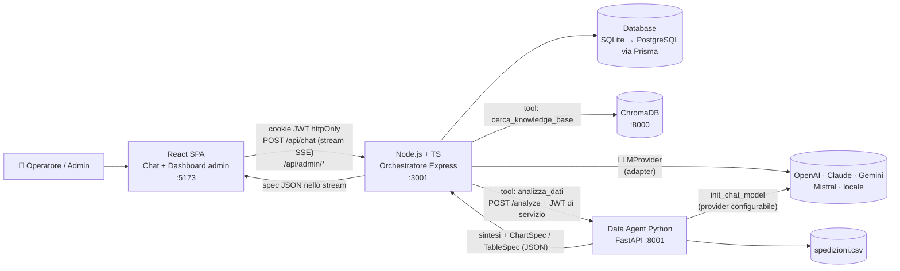

# LogisticAI - Copilota AI ibrido per Customer Service e Operations logistiche

> Documento di analisi e progettazione del progetto finale del Master.
> Stato: **bozza v3 - autenticazione, dashboard admin, livello AI indipendente dal provider** (11/10/2026)

---

## 0. Indice

1. [L'idea in breve](#1-lidea-in-breve)
2. [Perché la logistica](#2-perché-la-logistica)
3. [L'azienda: Padana Logistics S.r.l.](#3-lazienda-padana-logistics-srl)
4. [Utenti e ruoli](#4-utenti-e-ruoli)
5. [Il dataset CSV](#5-il-dataset-csv)
6. [La knowledge base (RAG)](#6-la-knowledge-base-rag)
7. [Architettura a microservizi](#7-architettura-a-microservizi)
8. [Back end - l'orchestratore](#8-back-end--lorchestratore)
9. [Livello AI indipendente dal provider](#9-livello-ai-indipendente-dal-provider)
10. [Autenticazione e sicurezza](#10-autenticazione-e-sicurezza)
11. [Persistenza, costi e osservabilità](#11-persistenza-costi-e-osservabilità)
12. [Data agent - Python](#12-data-agent--python)
13. [Front end - React](#13-front-end--react)
14. [Dashboard admin](#14-dashboard-admin)
15. [Privacy e conformità](#15-privacy-e-conformità)
16. [Struttura del repository](#16-struttura-del-repository)
17. [Configurazione](#17-configurazione)
18. [Domande demo](#18-domande-demo)
19. [Roadmap di sviluppo](#19-roadmap-di-sviluppo)
20. [Sfide tecniche previste](#20-sfide-tecniche-previste)
21. [Come diventa un prodotto vendibile](#21-come-diventa-un-prodotto-vendibile)
22. [Checklist rispetto al brief](#22-checklist-rispetto-al-brief)
23. [Decisioni](#23-decisioni)

---

## 1. L'idea in breve

**LogisticAI** è un copilota AI conversazionale per il **Customer Service e le Operations** di un operatore logistico conto terzi (3PL).
Da un'unica chat, accessibile solo agli utenti autenticati, risponde a due tipi di domande:

| Chi chiede | Cosa chiede | Strumento usato dall'agente |
|---|---|---|
| **Operatrice customer service** | "Il destinatario ha accettato un collo danneggiato senza firmare con riserva: possiamo ancora aprire la pratica?" | **RAG** su contratti, SLA, procedure |
| **Responsabile operations** | "Mostrami la percentuale di consegne puntuali per hub negli ultimi 6 mesi." | **Data agent Python** sullo storico spedizioni (CSV) |
| **Direzione / Key account** | "ModaNova ha diritto a penali per settembre secondo il suo SLA? A quanto ammontano?" | **RAG → data agent** (regole e formula di calcolo nel contratto, numeri nei dati) |

L'LLM decide da solo quale strumento usare, in che ordine e con quali parametri. Ogni risposta mostra **fonti contrattuali citate**, **grafici e tabelle interattivi** e le **operazioni di calcolo eseguite**, così ogni numero si può verificare.

> **Grafici e tabelle sono componenti React**, non immagini. Il data agent non disegna nulla: restituisce una **specifica JSON** (tipo di grafico, serie, dati, soglie) che il front end visualizza con componenti standard. L'utente può passare il mouse sui valori, cambiare tipo di grafico, nascondere serie, ordinare le tabelle ed esportare in CSV. Nessuna immagine matplotlib/seaborn/plotly, in nessun punto del sistema.

In più, LogisticAI ha tre caratteristiche da prodotto vero:
- **Accesso con login e ruoli** (operatore / admin). Anche la comunicazione tra i servizi interni è autenticata.
- **Dashboard admin** con costi AI, token, tempi di risposta, conversazioni, feedback 👍/👎 e risposte segnalate.
- **Indipendenza dal provider AI**: OpenAI, Claude, Gemini, Mistral o un modello locale si cambiano da configurazione, senza toccare l'architettura. Così si possono scegliere provider con dati ospitati in Europa.

---

## 2. Perché la logistica

**1. Il problema si misura in euro.**
- Ogni cliente ha uno SLA diverso: tempi di consegna garantiti, soglie di puntualità, penali, limiti di risarcimento, esclusioni. Gli operatori aprono il PDF del contratto ogni volta che un cliente chiama.
- Quando il cliente contesta il mese ("non avete rispettato lo SLA"), l'azienda non ha i numeri pronti. Paga penali che non doveva, o perde la discussione.
- Le procedure reclami e danni (riserva alla consegna, termini, documenti, massimali) esistono ma vengono applicate in modo incoerente.
- I margini sono bassi: la direzione deve capire quali clienti, servizi, tratte e subvettori fanno perdere soldi.

**2. Le domande ibride hanno un valore economico diretto.**
La domanda *"Dobbiamo pagare la penale e quanto?"* richiede di:
1. leggere lo SLA del cliente (soglia, formula della penale, esclusioni come "destinatario assente");
2. applicare quelle regole ai dati delle spedizioni;
3. calcolare l'importo.

È una catena di ragionamento in più passaggi (ReAct), con un risultato economico che chiunque capisce. È la dimostrazione più forte del progetto.

**3. C'è un mercato a cui venderlo.**
- In Italia ci sono migliaia di aziende di trasporto, corrieri regionali e 3PL, spesso poco digitalizzati.
- I software esistenti (gestionali di trasporto TMS e di magazzino WMS) **gestiscono le operazioni ma non rispondono a domande**: il livello "copilota AI" è ancora scoperto.
- È B2B, con budget più alti e decisioni più strutturate.
- Lo stesso prodotto si rivende anche agli **uffici logistica** di aziende manifatturiere ed e-commerce.

---

## 3. L'azienda: Padana Logistics S.r.l.

> Azienda **fittizia ma realistica**, ispirata ai 3PL della Pianura Padana (asse Piacenza–Verona).

| Voce | Valore |
|---|---|
| Ragione sociale | Padana Logistics S.r.l. |
| Sede | Castel San Giovanni (PC) |
| Attività | Logistica conto terzi: stoccaggio, preparazione ordini (picking), distribuzione in tutta Italia |
| Hub | **HUB-PC** Piacenza (sede, magazzino principale) - **HUB-VR** Verona (magazzino secondario, smistamento Nord-Est) |
| Dipendenti | ~140 (magazzino, customer service, operations, amministrazione) |
| Clienti | 10 aziende con contratto e SLA dedicati |
| Trasporto | Flotta propria sul Nord + 4 subvettori per il resto d'Italia |
| Volumi | ~25.000 spedizioni/anno (il CSV ne contiene un campione) |

### Clienti (usati sia nel CSV sia negli SLA della KB)

| Cliente | Settore | Note per i dati |
|---|---|---|
| ModaNova | Moda e-commerce B2C | Grande volume, resi frequenti, **sotto SLA ad ago–set 2026** |
| TechPoint | Elettronica | Merce di valore alto, volumi in crescita |
| BellaPelle Cosmetici | Cosmetica | Colli piccoli, molti verso il Sud |
| CasaViva Arredo | Arredamento | Colli voluminosi, **margine negativo** |
| FarmaSalus | Parafarmaco | Temperatura controllata, SLA molto stretto |
| GustoItaliano | Alimentare secco | Picco natalizio |
| BrianzaUtensili | Utensileria B2B | Consegne a negozi e officine, poche giacenze |
| KidsPlanet | Giocattoli | Fortissimo picco a novembre–dicembre |
| SportLab | Articoli sportivi | Stagionalità estiva |
| LibriMondo | Editoria | Volumi stabili, prezzo per collo basso |

### Vettori

| Codice | Nome | Copertura | Note per i dati |
|---|---|---|---|
| PAD | Flotta Padana (interna) | Nord | Riferimento di qualità |
| TRS | Trasporti Rossi S.r.l. | Centro | Nella media |
| VLX | VeloceExpress S.p.A. | Nord-Centro, Express | **Tasso danni ~3 volte la media** |
| SCG | SudCargo S.r.l. | Sud | Ritardi frequenti in Express |
| ISX | IsolExpress S.r.l. | Sicilia, Sardegna | Tempi lunghi |

Nomi di clienti, vettori, hub e servizi devono essere **identici** nel CSV e nella knowledge base: è il "ponte" che permette le domande ibride.

---

## 4. Utenti e ruoli

| Ruolo applicativo | Chi | Cosa può fare |
|---|---|---|
| `OPERATOR` | Customer service, operations, direzione | Usare la chat, vedere le **proprie** conversazioni, dare feedback 👍/👎 |
| `ADMIN` | Responsabile IT / AI owner | Tutto ciò che fa l'operatore + dashboard admin, gestione utenti, costi, conversazioni di tutti (con audit log, vedi §15) |

### Persona 1 - Sara, operatrice customer service (`OPERATOR`)
- **Problema:** gestisce 60 chiamate ed email al giorno. Ognuna richiede di consultare SLA, condizioni di trasporto o procedure.
- **Usa LogisticAI per:** tempi di consegna garantiti per cliente e area, gestione di giacenze e danni, documenti da chiedere, termini per i reclami.
- **Strumento:** RAG.

### Persona 2 - Luca, responsabile operations (`OPERATOR`)
- **Problema:** il report mensile di qualità lo prepara a mano in Excel. Scopre i problemi (un hub in ritardo, un subvettore che danneggia la merce) settimane dopo.
- **Usa LogisticAI per:** puntualità per hub, cliente, servizio e area; motivi di ritardo; tasso di danni per vettore; giacenze.
- **Strumento:** data agent (+ RAG per confrontare con soglie e regole di qualifica dei vettori).

### Persona 3 - Paola, direttrice operations e key account (`OPERATOR`, destinataria della presentazione)
- **Problema:** deve difendersi dalle contestazioni dei clienti, rinegoziare contratti e decidere quali subvettori tenere.
- **Usa LogisticAI per:** penali dovute, marginalità per cliente, vettori da sospendere secondo la procedura.
- **Strumento:** entrambi, in sequenza.

### Persona 4 - Davide, responsabile IT (`ADMIN`)
- **Problema:** deve garantire che l'AI costi il giusto, risponda bene e sia usata in modo corretto.
- **Usa la dashboard per:** costi per giorno/mese/periodo, risposte segnalate 👎, tempi di risposta, errori, gestione utenti, cambio del modello AI.

---

## 5. Il dataset CSV

**File:** `data/spedizioni.csv`
**Righe:** 12.000 spedizioni + 240 righe duplicate = **12.240** (minimo richiesto 1.000). Servono volumi mensili sufficienti per misurare lo SLA cliente per cliente (ModaNova ~120 spedizioni/mese).
**Periodo:** 01/10/2024 → 30/09/2026 (24 mesi, due picchi natalizi)
**Generazione:** script Python `data/generate_dataset.py` con `seed` fisso, quindi il dataset è riproducibile e lo script fa parte della consegna. Le regole contrattuali (tempi di resa, SLA, penali, soglie vettori) stanno in `data/business_rules.json`, unica fonte di verità per generatore e knowledge base. Il generatore scrive anche `data/anomalie_manifest.json`, che documenta ogni anomalia inserita.
**Privacy by design:** il dataset **non contiene dati personali** dei destinatari (niente nomi, indirizzi o telefoni: solo regione e area).

### 5.1 Colonne

| Colonna | Tipo | Esempio | Note |
|---|---|---|---|
| `id_spedizione` | stringa | `SP-2026-004812` | |
| `cliente` | categoria | `ModaNova` | |
| `hub_partenza` | categoria | `HUB-VR` | |
| `data_ritiro` | datetime | `2026-09-14 16:20` | |
| `data_consegna_prevista` | data | `2026-09-16` | Calcolata dai tempi di resa del servizio |
| `data_consegna_effettiva` | datetime | `2026-09-17 11:05` | Vuota se non consegnata |
| `regione_destinazione` | categoria | `Puglia` | |
| `area_destinazione` | categoria | `Sud` | Nord / Centro / Sud / Isole |
| `tipo_destinatario` | categoria | `B2C` | B2C / B2B |
| `servizio` | categoria | `Express 24h` | Standard 24/48h, Express 24h, Isole, Voluminoso |
| `vettore` | categoria | `SCG` | |
| `num_colli` | intero | `2` | |
| `peso_kg` | decimale | `7.4` | |
| `valore_merce_eur` | decimale | `189.00` | |
| `temperatura_controllata` | bool | `False` | Solo FarmaSalus |
| `stato` | categoria | `Consegnata` | Consegnata / In giacenza / Reso al mittente / Smarrita / In transito |
| `tentativi_consegna` | intero | `1` | |
| `motivo_ritardo` | categoria | `Destinatario assente` | Vuoto se puntuale. Imputabili a Padana: Traffico, Picco volumi hub, Mezzo guasto, Ritardo subvettore. Non imputabili: Meteo avverso, Destinatario assente, Indirizzo errato |
| `danno` | bool | `False` | |
| `riserva_alla_consegna` | bool | `True` | Solo se `danno`: il destinatario ha firmato con riserva specifica |
| `importo_reclamo_eur` | decimale | `0` | |
| `esito_reclamo` | categoria | | Accolto / Respinto / In corso / vuoto |
| `costo_trasporto_eur` | decimale | `6.80` | Costo sostenuto da Padana |
| `ricavo_eur` | decimale | `8.90` | Prezzo fatturato al cliente |

> Le colonne `motivo_ritardo` e `tipo_destinatario` sono fondamentali: gli SLA della KB **escludono** dal calcolo della puntualità alcune cause (per esempio "Destinatario assente", "Indirizzo errato" e forza maggiore). L'agente deve leggerlo nel contratto e applicarlo ai dati.

### 5.2 Anomalie inserite di proposito (~10% delle righe)

Servono a mettere alla prova la pulizia dati dell'agente. Ognuna va **documentata** (servirà nella presentazione).

| Tipo | Esempio | Quantità indicativa |
|---|---|---|
| Duplicati esatti | stessa spedizione registrata due volte | 1,5% |
| Quasi-duplicati | stesso `id_spedizione`, spazi o maiuscole diverse | 0,5% |
| Valori mancanti | `vettore`, `peso_kg`, `ricavo_eur`, `regione_destinazione` | 2,5% |
| Date in formati misti | `2026-03-14`, `14/03/2026`, `03-14-2026`, `14 mar 2026` | 2% |
| Categorie incoerenti | `ModaNova`, `modanova`, `Moda Nova`, `MODANOVA ` / `HUB-VR`, `Verona`, `VR` / `express 24h` | 2% |
| Numeri in formato italiano/testo | `"1.250,50"`, `"€ 8,90"`, `"7,4 kg"` | 0,7% |
| Fuori range | peso negativo o `9999` kg per un collo; ricavo `0`; costo negativo | 0,5% |
| Incoerenze logiche | consegna prima del ritiro; stato "Consegnata" senza data di consegna; date future; `danno=False` con importo reclamo > 0 | 0,5% |

### 5.3 Storie nascoste nei dati

Il generatore inserisce **pattern intenzionali**: così le analisi della demo trovano davvero qualcosa, e i grafici raccontano una storia.

1. **Picco natalizio a Verona:** a novembre–dicembre di entrambi gli anni la puntualità di HUB-VR crolla (motivo: "Picco volumi hub"), mentre HUB-PC tiene.
2. **ModaNova sotto SLA:** ad agosto e settembre 2026 la puntualità imputabile a Padana scende sotto la soglia contrattuale del 95% → **penale dovuta**. A luglio, invece, sembra sotto soglia solo se non si applicano le esclusioni: è la trappola che l'agente deve evitare.

   | Mese 2026 | Spedizioni | Puntualità senza esclusioni | Puntualità SLA (con esclusioni) | Punti sotto soglia | Penale (1.000 €/punto, tetto 5.000 €) |
   |---|---|---|---|---|---|
   | Luglio | 118 | 91,5% | 95,6% | 0 | 0 € |
   | Agosto | 62 | 93,6% | 93,6% | 1,5 | 1.500 € |
   | Settembre | 109 | 89,8% | 93,3% | 1,7 | 1.700 € |
3. **VeloceExpress danneggia:** tasso danni ~3 volte la media → supera la soglia di sospensione della procedura di qualifica vettori.
4. **Express al Sud:** l'Express 24h affidato a SudCargo rispetta i tempi di resa del catalogo in meno del 75% dei casi.
5. **CasaViva in perdita:** i colli voluminosi hanno un costo di trasporto superiore al ricavo → margine negativo.
6. **Il preavviso SMS funziona:** da marzo 2025 (introduzione della procedura "preavviso SMS" per le consegne B2C) le giacenze per "Destinatario assente" calano di ~40%.
7. **Crescita TechPoint:** volumi in aumento costante (+60% anno su anno).

---

## 6. La knowledge base (RAG)

**Formato di consegna:** un PDF principale `knowledge_base/Manuale_Operativo_Padana_Logistics.pdf`, generato da sorgenti Markdown versionate in `knowledge_base/source/*.md`.
**Lunghezza:** 16 pagine (copertina + 10 documenti), realistica e dettagliata, con dati coerenti con il CSV. Il PDF si rigenera con `knowledge_base/build_pdf.py`; 24 test (`knowledge_base/tests/`) verificano che soglie, penali, tempi di resa e vettori dei documenti coincidano con `data/business_rules.json` e che il PDF sia aggiornato rispetto alle sorgenti.

> L'ingestion legge le sorgenti `.md` (struttura a titoli pulita, chunking migliore). Il PDF è la versione "ufficiale" consegnata e leggibile da un umano. Valutare anche il parsing diretto del PDF per dimostrare che funziona.

### 6.1 Contenuti

| # | Documento | Contenuto chiave | Collegamento con i dati |
|---|---|---|---|
| 1 | **Organizzazione e contatti** | Hub, reparti, orari, escalation, reperibilità nel periodo di picco | `hub_partenza` |
| 2 | **Catalogo servizi e tempi di resa** | Tabella tempi di consegna per servizio × area (es. Standard Nord 24h, Sud 48h, Isole 72–96h), orari limite di ritiro | `servizio`, `area_destinazione`, `data_consegna_prevista` |
| 3 | **Condizioni generali di trasporto** | Responsabilità del vettore, **massimale di risarcimento per kg**, merci escluse, forza maggiore | `peso_kg`, `importo_reclamo_eur` |
| 4 | **Schede SLA per cliente** (10 schede) | Soglia di puntualità (es. ModaNova ≥ 95%), **formula della penale** (es. € X per ogni punto sotto soglia, tetto massimo mensile), **cause escluse dal calcolo**, modalità di misurazione | tutte le colonne di consegna |
| 5 | **Procedura reclami e danni** | Riserva alla consegna, termini per i danni occulti, documenti richiesti, tempi di risposta, iter interno | `danno`, `esito_reclamo` |
| 6 | **Gestione giacenze e tentativi di consegna** | Numero di tentativi, durata e costi della giacenza, quando scatta il reso al mittente, **procedura preavviso SMS (da marzo 2025)** | `stato`, `tentativi_consegna` |
| 7 | **Procedure di magazzino** | Ricevimento merce, stoccaggio, picking, inventario, catena del freddo per FarmaSalus | `temperatura_controllata` |
| 8 | **Merci pericolose e prodotti speciali** | Regole ADR semplificate, cosa si accetta e cosa no, colli voluminosi | `servizio = Voluminoso` |
| 9 | **Qualifica e valutazione subvettori** | KPI minimi: puntualità, **tasso danni > 1% → piano di miglioramento, > 2% per 2 mesi → sospensione** | `vettore`, `danno` |
| 10 | **FAQ del customer service** | Domande frequenti in formato Q&A | - |

### 6.2 Pipeline RAG

```
.md / .pdf ──► parsing ──► chunking per titolo (~600 token, overlap ~80)
          ──► embedding (tramite EmbeddingProvider, vedi §9)
          ──► ChromaDB collection "kb_padana"
               metadati: { documento, sezione, cliente?, vettore?, servizio? }
               metadati della collection: { embedding_provider, embedding_model, ingested_at }
```

- **Retrieval:** top-k = 5 per similarità coseno, con soglia minima di rilevanza. Sotto la soglia l'agente dice "non trovo questa informazione nei documenti" invece di inventare.
- **Filtri sui metadati:** se la domanda nomina un cliente (es. "ModaNova"), si cerca prima nella sua scheda SLA. Così si evita di confondere gli SLA di clienti diversi, che hanno testi molto simili.
- **Citazioni:** ogni chunk restituito porta `documento > sezione`. Il front end le mostra come "Fonti".
- **Embedding calcolati nel back end** tramite l'interfaccia `EmbeddingProvider` e passati a Chroma in modo esplicito. Così si usa lo stesso modello in indicizzazione e in query.
- **Protezione da modello sbagliato:** all'avvio il back end confronta il modello di embedding configurato con quello salvato nei metadati della collection. Se sono diversi si blocca e chiede `npm run ingest`, perché vettori di modelli diversi non sono confrontabili.
- **Script di ingestion idempotente:** `npm run ingest` cancella e ricrea la collection.

---

## 7. Architettura a microservizi



**Flusso di grafici e tabelle:** data agent → `ChartSpec`/`TableSpec` (JSON validato) → backend (salva nel DB, **non** li passa all'LLM) → front end (componenti React).

| Servizio | Tecnologia | Porta | Esposto a | Responsabilità |
|---|---|---|---|---|
| `frontend/` | React + Vite + TypeScript + Tailwind | 5173 | Browser | Chat, login, dashboard admin |
| `backend/` | Node.js + TypeScript + Express 5 + Prisma | 3001 | Solo front end (via proxy) | Autenticazione, conversazioni, orchestrazione ReAct, RAG, costi, API admin |
| Database | SQLite (sviluppo/consegna) → PostgreSQL (produzione) | file | Solo backend | Utenti, conversazioni, messaggi, chiamate LLM, feedback, audit |
| `vector_db/` | ChromaDB (`chroma run`, venv Python proprio) | 8000 | Solo backend (`127.0.0.1`) | Vector store persistente in `vector_db/chroma_data/` |
| `data_agent/` | Python + FastAPI + LangChain (tool calling su strumenti tipizzati) | 8001 | Solo backend (`127.0.0.1` + JWT di servizio) | Pulizia dati, analisi, spec di grafici e tabelle, sintesi |

### Scelte architetturali

| Decisione | Scelta | Motivazione |
|---|---|---|
| Linguaggio back end | **TypeScript su Node.js** | Node è richiesto dal brief; TypeScript dà contratti tipizzati tra servizi e lo stesso linguaggio del front end |
| Framework HTTP | **Express 5** | Standard di fatto, molta documentazione, middleware maturi (auth, rate limit, helmet) |
| Database | **Prisma + SQLite** | Nessuna installazione per il docente (è un file); passare a PostgreSQL in produzione richiede di cambiare una riga dello schema |
| Integrazione Node ↔ Python | **FastAPI** (non `child_process`) | Vero microservizio: CSV caricato una volta in memoria, health check, autenticazione, isolamento degli errori |
| LLM | **Interfaccia `LLMProvider` + adapter per provider** | Cambiare modello o provider = cambiare `.env` (§9) |
| Orchestrazione | **Loop ReAct scritto a mano** sopra `LLMProvider` | Controllo completo su trace, token e costi di ogni passaggio; nessun vincolo verso un framework |
| Grafici e tabelle | **Spec JSON + componenti React (Recharts)** | Interattivi (tooltip, cambio tipo, serie, ordinamento, export CSV), coerenti con la UI, accessibili, leggeri; nessun file immagine da gestire o proteggere |
| Contratto delle spec | **Schema unico** (zod in TS, pydantic in Python) + fixture JSON condivise | Il test di contratto fallisce se data agent e front end smettono di parlare la stessa lingua |
| Autenticazione utenti | **JWT in cookie httpOnly** | Il token non è leggibile da JavaScript (protezione XSS); funziona anche con lo stream SSE |
| Autenticazione tra servizi | **JWT di servizio a breve scadenza firmato con segreto condiviso** | Solo il back end può chiamare il data agent (§10.3) |
| Stati live | **Stream SSE sulla risposta di `POST /api/chat`** | L'utente vede in tempo reale cosa sta facendo l'agente |

---

## 8. Back end - l'orchestratore

### 8.1 Moduli

```
backend/src/
├── server.ts              ← avvio Express, middleware globali
├── config.ts              ← lettura e validazione .env (zod)
├── auth/                  ← login, logout, JWT, middleware requireAuth / requireAdmin
├── chat/                  ← rotte chat, conversazioni, feedback
├── orchestrator/          ← loop ReAct, tool, system prompt
├── llm/                   ← interfaccia LLMProvider + adapter (§9)
├── rag/                   ← Chroma, embedding, retriever, ingest
├── services/              ← client del data agent (con JWT di servizio)
├── telemetry/             ← registrazione chiamate LLM, calcolo costi
├── admin/                 ← API dashboard (statistiche, conversazioni, utenti, prezzi)
└── db/                    ← client Prisma
```

### 8.2 Endpoint

| Metodo | Path | Ruolo | Descrizione |
|---|---|---|---|
| `POST` | `/api/auth/login` | pubblico | `{ username, password }` → imposta il cookie JWT |
| `POST` | `/api/auth/logout` | autenticato | Cancella il cookie |
| `GET` | `/api/auth/me` | autenticato | Utente corrente e ruolo |
| `GET` | `/api/conversations` | operatore | Elenco delle **proprie** conversazioni |
| `GET` | `/api/conversations/:id` | operatore | Messaggi di una propria conversazione |
| `DELETE` | `/api/conversations/:id` | operatore | Archivia una propria conversazione |
| `POST` | `/api/chat` | operatore | `{ conversationId?, message, scope? }` → **stream SSE** (§8.4); `scope` = `{ type: 'document' \| 'category', id }` (§13.7) |
| `POST` | `/api/messages/:id/feedback` | operatore | `{ rating: 'up' \| 'down', reason?, comment? }` |
| `GET` | `/api/home` | operatore | Home: indicatori personali, conversazioni e documenti recenti; per l'admin costo di oggi, segnalazioni, servizi |
| `GET` | `/api/categories` | operatore | Categorie della libreria con conteggi |
| `POST` · `PATCH` | `/api/categories`, `/api/categories/:id` | admin | Crea o rinomina una categoria |
| `GET` | `/api/documents?categoria=&q=` · `/api/documents/:id` | operatore | Documenti della libreria con stato |
| `POST` | `/api/documents` | operatore | Caricamento multipart (`file`, `categoryId`, `title?`) → 202, elaborazione in coda |
| `DELETE` | `/api/documents/:id` | autore o admin | Elimina file, riga e sezioni indicizzate |
| `GET` | `/api/health` | pubblico | Stato di backend, DB, Chroma, data agent, provider LLM |
| `*` | `/api/admin/*` | admin | API della dashboard (§14) |

### 8.3 Tool esposti all'LLM

Definiti **una sola volta** in formato neutro (nome, descrizione, JSON Schema dei parametri). Ogni adapter li converte nel formato del proprio provider.

```ts
cerca_knowledge_base({ query: string; cliente?: string; top_k?: number })
// Per: SLA, tempi di resa, condizioni di trasporto, reclami, giacenze,
//      procedure di magazzino, regole sui subvettori, FAQ.

analizza_dati({ domanda: string; genera_grafico: boolean; regole_da_applicare?: string })
// Per: puntualità, ritardi, danni, giacenze, volumi, costi, margini, trend, classifiche.
// regole_da_applicare: soglie, formule ed esclusioni lette dalla KB,
//                      da passare al data agent quando servono.
```

Le descrizioni dei tool sono la parte più importante del routing: devono dire chiaramente **quando** usarli, con esempi positivi e negativi.

### 8.4 Stream SSE (stati live)

`POST /api/chat` risponde con `Content-Type: text/event-stream`. Il front end legge lo stream con `fetch` + `ReadableStream`, perché `EventSource` supporta solo GET.

| Evento | Payload | Uso nella UI |
|---|---|---|
| `start` | `{ conversationId }` | Id della conversazione (anche appena creata): se l'utente interrompe la prima risposta, la domanda successiva resta nella stessa conversazione |
| `status` | `{ stage: 'thinking' }` | "Sto ragionando…" |
| `tool_start` | `{ tool, args }` | "📘 Consulto i contratti…" / "📊 Analizzo le spedizioni…" |
| `tool_end` | `{ tool, durationMs, ok }` | Spunta verde sul passaggio completato |
| `delta` | `{ text }` | Testo della risposta finale, che compare man mano |
| `artifact` | `ChartSpec` o `TableSpec` | Il grafico o la tabella compare appena pronto, prima del testo finale |
| `done` | `ChatResponse` completa | Grafici, tabelle, fonti, badge, id messaggio (per il feedback) |
| `error` | `{ message, retryable }` | Bolla d'errore + "Riprova" |

Il pulsante **Interrompi** (al posto di Invia durante la risposta) annulla la fetch: il backend riceve l'abort, ferma l'orchestratore e il data agent e salva la risposta come interrotta. Nel client resta il testo già arrivato, con "Riprova". Durante lo stream l'unica fonte dei messaggi è il reducer della chat; a risposta completata la conversazione si ricarica dal server.

### 8.5 Contratto di risposta

```ts
interface ChatResponse {
  conversationId: string;
  messageId: string;                      // serve per il feedback 👍/👎
  reply: string;                          // markdown
  artifacts: Artifact[];                  // ChartSpec | TableSpec, vedi §12.3
  sources: { documento: string; sezione: string }[];
  toolsUsed: { name: ToolName; args: Record<string, unknown>; durationMs: number; ok: boolean }[];
  dataAgent?: { codice: string[]; pulizia: string[]; righeAnalizzate: number };
  usage: { inputTokens: number; outputTokens: number; costEur: number; latencyMs: number };
}
```

### 8.6 Loop ReAct (con catene di tool)

```
1. Carica dal DB la cronologia della conversazione (ultimi N messaggi) e aggiungi il messaggio utente
2. llm.chat({ system, messages, tools })            ← ogni chiamata viene registrata in llm_calls
3. Se l'LLM chiede uno o più tool:
      emetti tool_start → esegui (in parallelo se indipendenti) → emetti tool_end
      aggiungi i risultati → torna al punto 2
4. Se l'LLM risponde con testo → stream delta → salva messaggio, tool call, costi → emetti done
   (limiti: max 6 iterazioni; timeout per tool; errori dei tool restituiti all'LLM come testo)
```

**Esempio di catena - "ModaNova ha diritto a penali per settembre?"**
1. **Reason:** servono le regole contrattuali → **Act:** `cerca_knowledge_base({ query: "SLA penali puntualità", cliente: "ModaNova" })`
2. **Observe:** soglia 95%, penale € X per punto sotto soglia, tetto € Y, esclusi "Destinatario assente", "Indirizzo errato", forza maggiore
3. **Reason:** ora servono i numeri, calcolati con queste regole → **Act:** `analizza_dati({ domanda: "puntualità ModaNova settembre 2026", regole_da_applicare: "soglia 95%, escludi…, penale = …" })`
4. **Observe:** puntualità imputabile 92,8% → 3 punti sotto → penale € …
5. **Risposta:** importo + fonte contrattuale + grafico settimanale con la linea della soglia SLA + tabella di dettaglio

**Le spec non entrano nel contesto dell'LLM.** Il risultato del tool `analizza_dati` che l'orchestratore vede contiene solo la sintesi testuale e un riepilogo degli artifact (`"grafico a linee: puntualità settimanale, 5 punti"`). I dati completi vanno direttamente al front end e al DB: si risparmiano token e l'LLM non può alterare i numeri dei grafici.

Questa catena **sequenziale e dipendente** (l'output del primo tool diventa l'input del secondo) è il cuore della demo.

### 8.7 System prompt (linee guida)
- Ruolo: copilota del Customer Service e delle Operations di Padana Logistics.
- Per regole, SLA, procedure e soglie usa **solo** la knowledge base e cita le fonti; non usare conoscenza generica (nemmeno sul diritto dei trasporti).
- Per i numeri usa **solo** `analizza_dati`; non inventare cifre.
- Se la domanda richiede di applicare regole contrattuali ai dati → **prima** la KB, **poi** `analizza_dati` passando le regole trovate.
- Domande fuori ambito o saluti → rispondi senza tool.
- Rispondi in italiano, in modo sintetico e operativo; gli importi in euro con due decimali.
- Il prompt è **neutro rispetto al provider**. Eventuali ritocchi specifici per un modello stanno in file separati (`prompts/overrides/<provider>.ts`), non nel codice dell'orchestratore.

### 8.8 Dipendenze previste
- Runtime: Node.js ≥ 20, `tsx` per lo sviluppo, `tsc` per la build.
- HTTP e sicurezza: `express`, `cookie-parser`, `cors`, `helmet`, `express-rate-limit`.
- Auth: `jose` (JWT), `argon2` (hash password; in alternativa `bcrypt`).
- Dati: `prisma`, `@prisma/client`, `chromadb`, `zod`.
- LLM: SDK ufficiali dei provider usati (`openai`, `@anthropic-ai/sdk`, `@google/genai`, `@mistralai/mistralai`). Si installano solo quelli dei provider attivi.
- Log: `pino`.

---

## 9. Livello AI indipendente dal provider

**Obiettivo:** se domani si passa da OpenAI a Claude, Gemini o Mistral, **cambia solo la configurazione**. Al massimo si aggiunge un file adapter. Orchestratore, tool, RAG, database, dashboard e front end restano identici.

### 9.1 Il pattern: porte e adapter

Il resto del codice parla solo con **interfacce nostre**, mai con l'SDK di un provider:

```ts
// llm/types.ts - formato neutro, indipendente da qualsiasi provider
interface LLMProvider {
  readonly id: 'openai' | 'anthropic' | 'google' | 'mistral' | 'local';
  chat(req: LLMRequest): Promise<LLMResult>;
  chatStream(req: LLMRequest): AsyncIterable<LLMStreamEvent>;
}

interface LLMRequest {
  model: string;
  system: string;
  messages: NeutralMessage[];       // user | assistant | tool_result
  tools: ToolDefinition[];          // JSON Schema neutro
  temperature?: number;
  maxOutputTokens?: number;
}

interface LLMResult {
  text: string | null;
  toolCalls: { id: string; name: string; args: unknown }[];
  usage: { inputTokens: number; outputTokens: number; cachedInputTokens?: number };
  stopReason: 'end' | 'tool_calls' | 'max_tokens' | 'error';
  latencyMs: number;
}

interface EmbeddingProvider {
  readonly id: string;
  readonly model: string;
  embed(texts: string[]): Promise<{ vectors: number[][]; usage: { inputTokens: number } }>;
}
```

```
llm/
├── types.ts                 ← interfacce neutre
├── factory.ts               ← createLLMProvider(config) / createEmbeddingProvider(config)
├── adapters/
│   ├── openai.ts            ← anche Azure OpenAI (endpoint EU)
│   ├── anthropic.ts         ← anche Claude su AWS Bedrock / Google Vertex (regioni EU)
│   ├── google.ts            ← Gemini via Vertex AI (regioni EU)
│   ├── mistral.ts
│   └── local.ts             ← Ollama / vLLM (API compatibile OpenAI)
└── pricing.ts               ← prezzi per modello (letti dal DB, modificabili dalla dashboard)
```

Ogni adapter fa solo quattro cose:
1. converte i messaggi neutri nel formato del provider;
2. converte le definizioni dei tool;
3. traduce la risposta (testo + tool call) nel formato neutro;
4. estrae l'uso dei token.

### 9.2 Cosa cambia per passare a un altro provider

| Cosa | Dove | Obbligatorio? |
|---|---|---|
| `LLM_PROVIDER`, `LLM_MODEL`, chiave API / regione | `.env` | Sì |
| Riga prezzi del nuovo modello | Dashboard admin → Costi e modelli | Sì (per i costi corretti) |
| `DATA_LLM_PROVIDER`, `DATA_LLM_MODEL` | `.env` (data agent) | Solo se si cambia anche lì |
| `EMBEDDING_PROVIDER` / `EMBEDDING_MODEL` + `npm run ingest` | `.env` | Solo se si cambia il modello di embedding |
| Nuovo file in `llm/adapters/` | codice | Solo per un provider mai usato prima |

Il **data agent Python** è già indipendente dal provider: usa `init_chat_model("<provider>:<modello>")` di LangChain e un loop di tool calling su strumenti tipizzati, compatibile con qualunque modello che supporti i tool.

### 9.3 Test di conformità degli adapter
Una suite di test unica (`llm/__tests__/conformance.test.ts`) gira su ogni adapter con gli stessi scenari:
- risposta semplice;
- una tool call;
- due tool call in parallelo;
- risultato di un tool e risposta finale;
- conteggio dei token.

Se un nuovo adapter passa la suite, è compatibile con tutto il sistema.

**Nel progetto del Master:** si implementano **almeno 2 adapter** funzionanti (es. OpenAI + Anthropic) per dimostrare il cambio provider dal vivo. Gli altri restano documentati come estensione.

### 9.4 Opzioni con dati in Europa (da verificare in fase di scelta)

| Famiglia di modelli | Come usarla con dati in UE | Note |
|---|---|---|
| GPT (OpenAI) | Azure OpenAI con deployment in regione/data zone UE; oppure OpenAI API con data residency europea (requisiti contrattuali da verificare) | Adapter `openai` con endpoint Azure |
| Claude (Anthropic) | AWS Bedrock (regioni UE) o Google Vertex AI (regioni europee) | Adapter `anthropic` con client Bedrock/Vertex |
| Gemini (Google) | Vertex AI in regioni europee (es. Milano `europe-west8`, Francoforte, Belgio) | Adapter `google` in modalità Vertex |
| Mistral | API Mistral (azienda e infrastruttura europea) o self-hosting | Adapter `mistral` |
| Modelli open (Llama, Mistral, Qwen…) | On-premise con Ollama / vLLM | Dati mai fuori dall'azienda; qualità del tool calling inferiore, da testare |

Criteri di scelta da valutare dopo:
- qualità del tool calling sulle domande demo;
- costo per richiesta (misurato dalla dashboard);
- regione di elaborazione;
- **DPA** (accordo sul trattamento dei dati);
- **nessun addestramento sui dati inviati**;
- conservazione dei dati (preferibile zero data retention).

---

## 10. Autenticazione e sicurezza

Ci sono **due livelli distinti** di autenticazione:

```
Browser ──(1) utente: login + JWT in cookie──► Backend ──(2) servizio: JWT firmato con segreto condiviso──► Data agent
                                                  └──(2b) rete: Chroma e data agent ascoltano solo su 127.0.0.1
```

### 10.1 Utenti (livello 1)
- **Login** con username + password. Le password sono salvate con **argon2** (mai in chiaro).
- Al login il backend emette un **JWT** firmato (`JWT_SECRET`, algoritmo HS256), con `sub` = id utente, `role` e scadenza di 8 ore.
- Il JWT sta in un **cookie `httpOnly`, `SameSite=Strict`**, `Secure` in produzione:
  - JavaScript non può leggerlo (protezione da XSS);
  - `SameSite=Strict` + stesso origin (proxy Vite) proteggono dal CSRF;
  - il browser lo invia da solo a ogni chiamata `/api`, anche per lo stream SSE.
- Middleware `requireAuth` su tutte le rotte `/api/*` tranne login e health; `requireAdmin` su `/api/admin/*`.
- **Controllo di proprietà:** un operatore può leggere solo le proprie conversazioni e i propri grafici.
- **Rate limiting:** login (es. 5 tentativi/minuto per IP) e chat (es. 20 messaggi/minuto per utente).
- Utenti disattivati dall'admin: il token viene rifiutato alla richiesta successiva (controllo `active` sul DB).

### 10.2 Utenti di test (documentati nel README)
Creati da `npm run seed`, con password lette dal `.env` e valori predefiniti uguali a quelli del README:

| Username | Ruolo | Password demo |
|---|---|---|
| `admin` | ADMIN | definita in `SEED_ADMIN_PASSWORD` |
| `sara.operatrice` | OPERATOR | definita in `SEED_OPERATOR_PASSWORD` |

> Credenziali **solo per la demo**: il README lo dice esplicitamente.

### 10.3 Tra servizi (livello 2): backend → data agent
Il data agent **non deve accettare richieste da nessun altro** oltre al backend.
- Backend e data agent condividono un segreto, `INTERNAL_SERVICE_SECRET`, nel `.env`.
- Per ogni chiamata il backend genera un **JWT di servizio** firmato con quel segreto:
  - `iss: logisticai-backend`, `aud: data-agent`;
  - scadenza **60 secondi**;
  - `sub` = id utente e `jti` = id richiesta, per tracciabilità.
- FastAPI lo verifica con una dependency (PyJWT): firma, `aud`, `iss`, scadenza. Se non è valido → `401`.
- In più il data agent ascolta solo su `127.0.0.1`: difesa su due livelli.
- **Perché un JWT e non una semplice API key statica?** Scade dopo un minuto (un token intercettato è inutile poco dopo), lega la richiesta a utente e conversazione nei log, e lo standard è lo stesso usato per gli utenti.
- **Chroma:** in locale ascolta su `127.0.0.1`. In produzione si attiva l'autenticazione a token di Chroma.

### 10.4 Altre misure
- `helmet` per gli header di sicurezza; CORS limitato a `FRONTEND_ORIGIN`.
- Validazione zod di tutti gli input HTTP **e** degli argomenti dei tool generati dall'LLM.
- Lunghezza massima del messaggio.
- Le spec di grafici e tabelle sono **solo dati**: validate dallo schema, renderizzate da componenti React (nessun HTML o codice eseguito nel browser), con limiti di dimensione (righe e punti massimi).
- Il data agent **non esegue codice generato dal modello**: può solo chiamare strumenti tipizzati con argomenti validati (§12.5). Le regole lette dai documenti caricati arrivano come testo e al massimo cambiano i parametri di un calcolo.
- Nessun segreto nel codice: `config.ts` valida il `.env` all'avvio e si ferma con un messaggio chiaro se manca qualcosa.

---

## 11. Persistenza, costi e osservabilità

### 11.1 Modello dati (Prisma)

| Tabella | Campi principali | Scopo |
|---|---|---|
| `User` | id, username, passwordHash, role, active, createdAt, lastLoginAt | Utenti |
| `Conversation` | id, userId, title, createdAt, updatedAt, archivedAt | Memoria conversazionale persistente |
| `Message` | id, conversationId, role, content, status (ok/error), latencyMs, createdAt | Messaggi utente e AI |
| `ToolCall` | id, messageId, tool, args (JSON), resultSummary, durationMs, ok, error | Cosa ha deciso e fatto l'agente |
| `MessageArtifact` | id, messageId, type (chart/table/source/data_agent), payload (JSON) | Spec di grafici e tabelle, fonti, codice eseguito: la conversazione si riapre identica |
| `LlmCall` | id, messageId, conversationId, userId, component (orchestrator/embedding/data_agent), provider, model, inputTokens, outputTokens, cachedTokens, costUsd, costEur, latencyMs, ok, createdAt | **Base di tutte le metriche di costo** |
| `Feedback` | id, messageId, userId, rating (up/down), reason, comment, status (new/reviewing/resolved), adminNote, createdAt | Feedback e revisione |
| `ModelPricing` | provider, model, inputPer1M, outputPer1M, cachedInputPer1M, currency, validFrom | Prezzi modificabili senza toccare il codice |
| `AuditLog` | id, actorId, action, targetType, targetId, createdAt | Chi ha visto o modificato cosa (es. admin che apre una conversazione) |
| `Setting` | key, value | Budget, retention, modello attivo mostrato in dashboard |

### 11.2 Come si calcolano i costi
- **Ogni** chiamata a un modello genera una riga `LlmCall`: le iterazioni dell'orchestratore, gli embedding delle query RAG e le chiamate interne del data agent. Il data agent restituisce il proprio uso dei token nella risposta di `/analyze` e il backend lo registra.
- `costo = inputTokens × prezzoInput + outputTokens × prezzoOutput (+ token in cache × prezzo cache)`, usando il `ModelPricing` valido alla data della chiamata. Così cambiare i prezzi non riscrive il passato.
- Valori salvati in USD (valuta dei listini) e convertiti in EUR con un tasso configurabile.
- **Costo di una risposta** = somma delle `LlmCall` del messaggio. **Costo di una conversazione** = somma dei suoi messaggi.

### 11.3 Budget e allarmi
- `DAILY_BUDGET_EUR` e `MONTHLY_BUDGET_EUR`: oltre l'80% compare un avviso in dashboard; oltre il 100% (opzionale) la chat risponde "servizio temporaneamente sospeso".
- Limite opzionale di costo giornaliero per utente.

### 11.4 Log tecnici
`pino` con un `requestId` che attraversa backend → data agent (nel JWT di servizio). In questo modo un errore si ricostruisce da un capo all'altro.

---

## 12. Data agent - Python

### 12.1 Endpoint FastAPI (tutti protetti da JWT di servizio tranne `/health`)

| Metodo | Path | Descrizione |
|---|---|---|
| `POST` | `/analyze` | `{ domanda, genera_grafico, regole_da_applicare? }` → analisi + spec di grafici e tabelle + uso token |
| `GET` | `/health` | Stato del servizio, righe caricate, avvisi di validazione e statistiche della cache |
| `GET` | `/data-quality` | Report delle anomalie trovate nel CSV grezzo e della validazione di colonne e tipi |

### 12.2 Flusso interno

```
avvio ──► carica_dataset(): colonne e tipi attesi? ── no ──► il servizio non parte e dice perché
            │ sì
            ▼
         pulisci_dataset() una volta (report di pulizia) + colonne derivate (anno, giorni_ritardo)

domanda (+ regole) ──► cache: stessa richiesta normalizzata sullo stesso CSV? ── sì ──► risposta salvata (0 token)
            │ no
            ▼
         loop di tool calling (modello da init_chat_model(DATA_LLM_PROVIDER:DATA_LLM_MODEL)),
         il modello può SOLO chiamare questi strumenti, con argomenti validati da pydantic:
            - calcola_puntualita / calcola_tasso_danni / calcola_margine / aggrega
                                          → filtri per valore e periodo, raggruppamenti, ordinamento: risultato R1, R2, ...
            - verifica_sla_mensile        → penale SLA di un cliente in un mese
            - valuta_subvettori           → esito della procedura di qualifica
            - crea_grafico(risultato, …)  → registra una ChartSpec (validata con pydantic)
            - crea_tabella(risultato, …)  → registra una TableSpec (validata con pydantic)
            ▼
         { sintesi, artifacts[], codice_eseguito[] (operazioni eseguite), pulizia[], righe_analizzate,
           usage: [{ provider, model, input_tokens, output_tokens, latency_ms }], dalla_cache }
```

L'uso dei token si raccoglie con il callback di LangChain sui metadati d'uso, che è indipendente dal provider.

**Perché strumenti tipizzati e non codice generato?**
- `cleaning.py` gestisce in modo riproducibile e testabile le anomalie note (duplicati, date, categorie, numeri, fuori range) e produce un **report**, applicato sempre.
- L'agente **decide** quale calcolo fare e con quali parametri (filtri, periodo, raggruppamenti, esclusioni, soglie), in catena e correggendosi sugli errori restituiti dagli strumenti. Nella sintesi spiega cosa è stato pulito.
- Nella prima versione l'agente scriveva ed eseguiva codice pandas. Le "regole da applicare" però arrivano dai documenti, che chiunque può caricare: un documento con istruzioni malevole poteva far eseguire codice arbitrario nel processo del servizio. Con gli strumenti tipizzati colonne e operazioni sono elenchi chiusi, i valori dei filtri si confrontano per uguaglianza (nessuna query string, `eval` o codice) e il peggio che un testo ostile può ottenere è un calcolo diverso.
- È il compromesso tra autonomia dell'agente (richiesta dal brief) e affidabilità (necessaria quando i numeri diventano penali da pagare).

**Perché l'helper `calcola_puntualita()`?** La puntualità è il KPI su cui si calcolano le penali: non può cambiare definizione da una domanda all'altra. L'helper la rende coerente e testabile; l'agente sceglie filtri, periodo, raggruppamenti ed esclusioni.

### 12.3 Grafici e tabelle: spec JSON, mai immagini

Il data agent **non usa librerie grafiche** (niente matplotlib, seaborn, plotly). Produce spec JSON che il front end visualizza con componenti React.

```ts
type ChartType = 'bar' | 'line' | 'area' | 'pie' | 'scatter' | 'composed';
type ValueFormat = 'number' | 'integer' | 'percent' | 'currency_eur' | 'duration_min' | 'date' | 'string';

interface ChartSpec {
  kind: 'chart';
  id: string;                        // uuid
  type: ChartType;
  title: string;
  subtitle?: string;
  xKey: string;                      // colonna dell'asse X / categorie
  xLabel?: string;
  yLabel?: string;
  yFormat?: ValueFormat;
  series: {
    key: string;
    label: string;
    type?: 'bar' | 'line' | 'area'; // solo per 'composed'
    color?: string;                  // opzionale, altrimenti palette del tema
  }[];
  data: Record<string, string | number | null>[];   // max 500 punti
  stacked?: boolean;
  horizontal?: boolean;
  referenceLines?: { axis: 'y' | 'x'; value: number; label: string }[];  // es. soglia SLA 95%
  allowedTypes?: ChartType[];        // tipi tra cui l'utente può passare (es. bar ↔ line)
}

interface TableSpec {
  kind: 'table';
  id: string;
  title: string;
  columns: { key: string; label: string; format?: ValueFormat; align?: 'left' | 'right' | 'center' }[];
  rows: Record<string, string | number | null>[];  // max 1.000 righe
  totals?: Record<string, string | number | null>;
  defaultSort?: { key: string; direction: 'asc' | 'desc' };
}

type Artifact = ChartSpec | TableSpec;
```

- **Strumenti dell'agente:** `crea_grafico(risultato, tipo, x, y, titolo, …)` e `crea_tabella(risultato, titolo, …)` partono da un risultato già calcolato (`R1`, `R2`, …). Convertono il DataFrame (date in ISO, `NaN` → `null`, numpy → tipi nativi), validano la spec con pydantic e la registrano. Se la spec non è valida, l'errore torna all'agente, che corregge e riprova.
- **Fonte di verità:** il servizio restituisce solo le spec registrate dagli helper, senza fidarsi del testo dell'LLM.
- **Limiti:** max 500 punti per grafico e 1.000 righe per tabella: oltre, l'helper restituisce all'agente un errore che chiede di aggregare, e l'agente riprova.
- **Contratto condiviso:** schema zod in `shared/types` e modello pydantic in `data_agent/specs.py`, verificati dalle **stesse fixture JSON** (`shared/contracts/fixtures/`) in entrambi i linguaggi.

### 12.4 Sintesi narrativa
Prompt finale: tradurre i numeri in **insight per un responsabile**: cosa emerge, perché è importante, cosa fare. Esempio: *"A settembre la puntualità imputabile su ModaNova è stata del 92,8%, sotto la soglia del 95%. Il 70% dei ritardi viene da HUB-VR verso il Sud con SudCargo."*

### 12.5 Rischi e mitigazioni
- **Nessuna esecuzione di codice** (vedi §12.2): `test_boundaries.py` vieta nel servizio `allow_dangerous_code`, `langchain_experimental`, REPL Python, `eval(`, `exec(` e `.query(`. Restano servizio solo su `127.0.0.1` + JWT di servizio, `max_iterations` limitato, timeout, CSV in sola lettura.
- Argomenti sbagliati o valori inesistenti (es. un cliente scritto male) → lo strumento restituisce all'agente un errore leggibile con i valori ammessi, e l'agente riprova.

### 12.7 Validazione, cache e prestazioni
- **Validazione all'avvio** (`dataset.py`): colonne attese e tipo di ogni colonna (date, numeri, interi, booleani) controllati con le stesse regole della pulizia. Oltre il 5% di valori non interpretabili, una colonna mancante o un file vuoto il servizio non parte e spiega cosa non va; anomalie minori diventano avvisi visibili in `/data-quality`.
- **Cache delle risposte** (`cache.py`): in memoria, chiave = domanda e regole normalizzate (maiuscole, accenti, punteggiatura e spazi non contano) + richiesta di grafico + impronta SHA-256 del CSV. TTL e numero di voci da `.env` (`DATA_AGENT_CACHE_TTL_S`, `DATA_AGENT_CACHE_MAX_VOCI`). Una risposta dalla cache non chiama il modello (costo zero) e riceve id nuovi per gli artifact. Gli errori non si salvano.
- **Benchmark** (`benchmark.py`, risultati in `data_agent/benchmark/RISULTATI.md`): tempo e picco di memoria di caricamento, validazione, pulizia e delle analisi più frequenti su dataset da 12 mila a ~490 mila righe, con soglie esplicite per decidere quando introdurre Parquet, DuckDB o SQLite. Esito: tutto cresce in modo lineare. A 490 mila righe (40 volte lo storico) l'analisi più lenta richiede 0,12 s e l'avvio 16 s; la prima soglia superata sarebbe l'avvio (30 s) intorno alle 900 mila righe, quindi il primo intervento sarà salvare il dataset pulito in Parquet; DuckDB serve oltre 1,2 milioni di righe circa, quando la memoria supera 1 GB.

### 12.6 Dipendenze previste
- Base: `fastapi`, `uvicorn`, `pydantic`, `pyjwt`, `python-dotenv`.
- Dati: `pandas`, `numpy` (**nessuna** libreria grafica).
- LangChain: `langchain`, più il pacchetto del provider attivo (`langchain-openai` / `langchain-anthropic` / `langchain-google-vertexai` / `langchain-mistralai`).
- Test: `pytest`.

---

## 13. Front end - React

### 13.1 Stack
- React + Vite (template `react-ts`) + **Tailwind CSS** (`@tailwindcss/vite`) + `@tailwindcss/typography`
- `react-router` (rotte e protezione per ruolo)
- `@tanstack/react-query` (chiamate API, cache, stati di caricamento)
- `react-markdown` + `remark-gfm` (risposte con tabelle)
- `recharts`: **tutti** i grafici, sia in chat sia nella dashboard admin
- `@tanstack/react-table`: tabelle con ordinamento, paginazione e formattazione
- `lucide-react` (icone)
- Proxy Vite: `/api` → `http://localhost:3001` (stesso origin, cookie `SameSite=Strict` funzionante)

### 13.2 Rotte

| Rotta | Accesso | Pagina |
|---|---|---|
| `/login` | pubblico | Login in due parti (pannello di marca e modulo) |
| `/` | operatore | Home: dashboard personale (e indicatori admin) |
| `/documenti` · `/documenti/:categoriaId` | operatore | Libreria per categorie, elenco documenti, caricamento |
| `/chat` · `/chat/:conversationId` · `/chat?documento=ID` · `/chat?categoria=ID` | operatore | Chat con elenco conversazioni ed eventuale ambito |
| `/admin` | admin | Dashboard |
| `/admin/conversazioni` · `/admin/conversazioni/:id` | admin | Elenco conversazioni e dettaglio con trace |
| `/admin/feedback` | admin | Risposte segnalate |
| `/admin/costi` | admin | Costi, modelli, prezzi, budget |
| `/admin/utenti` | admin | Gestione utenti |
| `/admin/sistema` | admin | Stato dei servizi e della knowledge base |

### 13.3 Componenti della chat

| Componente | Funzione |
|---|---|
| `ConversationSidebar` | Elenco delle conversazioni, nuova chat, archivia |
| `ChatWindow` | Lista messaggi, auto-scroll |
| `MessageBubble` | Markdown + artifact (grafici e tabelle) |
| `LiveStatus` | Indicatore di digitazione + passaggi live dallo stream SSE ("📘 Consulto i contratti… ✓", "📊 Analizzo le spedizioni…") |
| `ArtifactRenderer` | Sceglie il componente in base a `kind` (`chart` → `DataChart`, `table` → `DataTable`) |
| `DataChart` | Grafico Recharts generato dalla `ChartSpec` (vedi §13.4) |
| `DataTable` | Tabella generata dalla `TableSpec` (vedi §13.4) |
| `ToolBadge` | Badge 📘 *Knowledge base* / 📊 *Data agent* nell'ordine di chiamata: rende visibile la decisione dell'LLM |
| `SourcesList` | Fonti documentali citate |
| `CodePanel` | Pannello richiudibile "Mostra codice eseguito e pulizia dati" |
| `FeedbackButtons` | 👍 / 👎; sul 👎 si apre un piccolo modulo con motivo e commento opzionale |
| `SuggestedQuestions` | Domande di esempio nella schermata iniziale |
| `Composer` | Input, invio con Enter, disabilitato durante lo stream |
| `AiDisclosure` | Nota fissa: "Stai usando un assistente AI. Le conversazioni sono registrate per migliorare il servizio" (§15) |

### 13.4 Componenti di grafici e tabelle

Componenti **standard e riusabili**: gli stessi si usano in chat e nella dashboard admin.

**`DataChart`** (Recharts)
- Tipi: barre (verticali/orizzontali, raggruppate/impilate), linee, aree, torta/ciambella, dispersione, combinato barre + linea.
- Opzioni nella barra del grafico:
  - **cambio tipo** tra quelli ammessi da `allowedTypes` (es. barre ↔ linee);
  - **mostra/nascondi serie** cliccando sulla legenda;
  - **tooltip** con valori formattati (€, %, minuti, date in italiano);
  - **linee di riferimento** (es. soglia SLA) con etichetta;
  - **schermo intero**;
  - **esporta CSV** dei dati del grafico;
  - **"Vedi dati"**: passa alla tabella con gli stessi dati.
- Palette del tema (chiaro/scuro), accessibile e coerente con la UI; contenitore responsive.

**`DataTable`** (TanStack Table)
- Ordinamento per colonna, paginazione (oltre 20 righe), riga dei totali.
- Formattazione per colonna (`currency_eur`, `percent`, `date`…), numeri allineati a destra.
- Ricerca testuale nella tabella ed **esporta CSV**.
- Intestazione fissa e scroll orizzontale su schermi piccoli.

**Tabelle in markdown:** se l'LLM scrive una piccola tabella nel testo (es. un riepilogo di 3 righe), `react-markdown` la visualizza con lo stesso stile di `DataTable`. Le tabelle di dati vere arrivano sempre come `TableSpec`.

### 13.5 Feedback dell'utente
- 👍 / 👎 su ogni risposta dell'AI, modificabile.
- Sul 👎, motivi rapidi: *Risposta errata* · *Numeri sbagliati* · *Fonte non pertinente* · *Incompleta* · *Troppo lenta* · *Altro*, più un commento libero.

### 13.6 UX
- Identità visiva "Cargo": menu laterale nero caffè (#181010), corallo (#FF6F59) come unico colore d'accento, sfondo #FDFDFD e superfici grigio caldo #F7F3F3; soglie dei grafici in nero caffè tratteggiato; font Instrument Sans; logo a due container impilati con il punto nero caffè della destinazione. Grafici con barre arrotondate, griglia leggera, tooltip a scheda e legenda a pillole.
- Tutte le pagine (comprese quelle di amministrazione) stanno nello stesso guscio con il menu laterale, che mostra la sezione Amministrazione solo all'admin.
- Responsive: utilizzabile anche da tablet in magazzino.
- Errori mostrati nella bolla, con pulsante "Riprova".
- I tipi condivisi (`ChatResponse`, eventi SSE, `ChartSpec`/`TableSpec`, DTO admin) stanno in `shared/types/`, importati sia dal front end sia dal back end.


### 13.7 Libreria documenti e chat con ambito
Progetto approvato in `docs/superpowers/specs/2026-10-12-piattaforma-completa-design.md`.
- **Chi carica:** tutti gli utenti; il documento è subito visibile a tutti e l'assistente lo usa appena indicizzato. Elimina l'autore o l'admin. Categorie: 6 iniziali, l'admin ne crea e le rinomina.
- **Elaborazione nel backend** (nessun nuovo servizio): controllo di estensione, firma reale del file e dimensione (15 MB), duplicati per checksum nella stessa categoria; estrazione del testo (PDF `unpdf`, Word `mammoth`, TXT, MD), sezioni per titoli o blocchi di paragrafi, embedding e scrittura in Chroma con `documentId` e `categoryId`. Stato `processing` → `ready` oppure `error` con il motivo (es. PDF scansionato). All'avvio si riprendono i documenti rimasti a metà.
- **Chat con ambito:** "Chiedi a questo documento" (o a una categoria) apre la chat con un'etichetta corallo. L'orchestratore offre solo lo strumento documentale, il retriever filtra per documento o categoria e l'ambito resta salvato sulla conversazione. Fuori ambito l'assistente dice di non trovare l'informazione e propone di togliere il filtro.

---

## 14. Dashboard admin

### 14.1 Panoramica
- **Selettore di periodo:** oggi · 7 giorni · mese corrente · intervallo personalizzato.
- **Card KPI:** costo AI del periodo (€) · costo di oggi · costo del mese con barra del budget · n° richieste · **costo medio per richiesta** · costo medio per conversazione · token in/out · **latenza media e p95** · % feedback positivi · tasso di errore · utenti attivi.
- **Grafici:**
  - costo giornaliero, diviso per componente (orchestratore / embedding / data agent);
  - richieste per giorno;
  - **distribuzione delle decisioni dell'agente:** solo RAG · solo dati · RAG + dati · nessun tool;
  - latenza nel tempo (media e p95);
  - token di input e output nel tempo;
  - andamento del feedback (👍 vs 👎).

### 14.2 Conversazioni
- Tabella con filtri: utente · periodo · strumento usato · con 👎 · con errori · costo superiore a una soglia · testo libero.
- **Dettaglio con trace completo**, per ogni risposta:
  - messaggi, tool call con argomenti e durata, fonti, codice eseguito e pulizia dati, grafici e tabelle (visualizzati con gli stessi componenti della chat);
  - per ogni passaggio: modello usato, token, costo, latenza.
  È lo strumento principale per capire **perché** l'AI ha risposto in un certo modo.
- Ogni apertura di una conversazione viene registrata nell'`AuditLog`.

### 14.3 Feedback e risposte segnalate
- Coda delle risposte 👎 con motivo, commento, utente, data e link alla conversazione.
- Stato di revisione: *Nuovo → In analisi → Risolto*, più nota dell'admin (es. "aggiunta FAQ sulla giacenza nella KB").
- Statistiche: % negativi per strumento (RAG vs dati), motivi più frequenti, andamento nel tempo.
- Esportazione CSV, per migliorare prompt e knowledge base.

### 14.4 Costi e modelli
- Ripartizione dei costi per provider · modello · componente · utente.
- Tabella **prezzi dei modelli** modificabile (con data di validità).
- Budget giornaliero e mensile, soglia di allarme.
- Modello attivo per orchestratore, data agent ed embedding (in sola lettura: si cambia dal `.env`).
- **Confronto tra modelli:** se nel periodo sono stati usati provider diversi, costo medio, latenza e % 👍 affiancati. Serve a scegliere il provider con i dati alla mano.

### 14.5 Utenti
Elenco con ultimo accesso, n° richieste e costo per utente · creazione utente · disattivazione · reset password · cambio ruolo.

### 14.6 Sistema
- Stato in tempo reale di backend, database, Chroma, data agent e provider LLM.
- Knowledge base: n° documenti e chunk, modello di embedding, data dell'ultima ingestion.
- Dataset: righe caricate e report di data quality.
- Ultimi errori.

---

## 15. Privacy e conformità

> Orientamento progettuale, **non un parere legale**. Prima di vendere il prodotto va validato con un consulente privacy / DPO.

**È lecito che l'admin legga le chat?** In generale sì, ma solo a certe condizioni. Le conversazioni avvengono su uno strumento di lavoro aziendale e il monitoraggio serve alla qualità del servizio AI. Le regole da rispettare:

| Tema | Riferimento | Come lo gestisce LogisticAI |
|---|---|---|
| Informare gli utenti | GDPR art. 13 | Nota `AiDisclosure` sempre visibile + informativa al primo accesso |
| Finalità limitata | GDPR art. 5 | Le chat servono a qualità e costi dell'AI, **non** a valutare i dipendenti (dichiarato nell'informativa) |
| Controlli a distanza dei lavoratori | Statuto dei lavoratori art. 4 | Strumento di lavoro + informativa adeguata. Se si volessero usare i dati per valutazioni individuali, servirebbero accordo sindacale o autorizzazione: **escluso per scelta di progetto** |
| Minimizzazione | GDPR art. 5 | Il dataset non contiene dati personali dei destinatari; gli utenti sono avvisati di non scrivere dati personali nella chat |
| Conservazione | GDPR art. 5 | `CHAT_RETENTION_DAYS` (es. 180): un job cancella o anonimizza le conversazioni più vecchie |
| Accesso limitato e tracciato | GDPR art. 32 | Solo il ruolo ADMIN; ogni apertura di una chat finisce nell'`AuditLog` |
| Pseudonimizzazione | GDPR art. 25 | In dashboard gli utenti appaiono come `Utente #12`; il nome si mostra con un click, che viene registrato |
| Trasparenza AI | AI Act, obblighi di trasparenza | L'utente sa sempre di parlare con un sistema AI |
| Dati inviati al provider LLM | GDPR artt. 28 e 44+ | Provider con DPA, regione UE, nessun addestramento sui dati (§9.4) |

---

## 16. Struttura del repository

```
logisticai/
├── README.md
├── PROGETTO.md                     ← questo documento
├── .gitignore
├── .env.example                    ← template senza segreti
├── data/
│   ├── spedizioni.csv
│   └── generate_dataset.py
├── knowledge_base/
│   ├── Manuale_Operativo_Padana_Logistics.pdf
│   ├── source/                     ← sorgenti .md dei 10 documenti
│   └── build_pdf.py
├── shared/
│   ├── types/                      ← tipi TS + schemi zod condivisi (ChatResponse, SSE, ChartSpec, TableSpec)
│   └── contracts/fixtures/         ← JSON di esempio validati sia da zod sia da pydantic (test di contratto)
├── backend/
│   ├── package.json
│   ├── tsconfig.json
│   ├── prisma/
│   │   ├── schema.prisma
│   │   └── seed.ts                 ← utenti demo + prezzi modelli
│   └── src/
│       ├── server.ts
│       ├── config.ts
│       ├── auth/                   ← login, JWT, middleware
│       ├── chat/                   ← rotte chat, conversazioni, feedback, SSE
│       ├── orchestrator/           ← agent.ts (ReAct), tools.ts, systemPrompt.ts, prompts/overrides/
│       ├── llm/                    ← types.ts, factory.ts, adapters/, pricing.ts, __tests__/
│       ├── rag/                    ← chromaClient.ts, retriever.ts, ingest.ts
│       ├── services/               ← dataAgentClient.ts (JWT di servizio)
│       ├── telemetry/              ← registrazione LlmCall, calcolo costi, budget
│       ├── admin/                  ← API dashboard
│       └── db/
├── data_agent/
│   ├── requirements.txt
│   ├── main.py                     ← FastAPI + verifica JWT di servizio
│   ├── auth.py
│   ├── agent.py                    ← loop di tool calling (init_chat_model)
│   ├── strumenti.py                ← strumenti tipizzati: calcoli, grafici e tabelle (nessun codice eseguito)
│   ├── cache.py                    ← cache delle risposte (TTL + LRU, impronta del CSV)
│   ├── benchmark.py                ← tempi e memoria su dataset crescenti
│   ├── cleaning.py
│   ├── kpi.py                      ← calcola_puntualita() e altri helper
│   ├── specs.py                    ← modelli pydantic ChartSpec / TableSpec
│   ├── artifacts.py                ← crea_grafico() / crea_tabella()
│   └── tests/
├── vector_db/                      ← ChromaDB: requirements.txt + venv proprio, dati in chroma_data/ (ignorati da git)
├── frontend/
│   ├── package.json
│   ├── vite.config.ts
│   └── src/
│       ├── main.tsx
│       ├── App.tsx                 ← router
│       ├── index.css               ← @import "tailwindcss"
│       ├── api/                    ← client HTTP + parser SSE
│       ├── auth/                   ← contesto utente, ProtectedRoute
│       ├── pages/
│       │   ├── LoginPage.tsx
│       │   ├── ChatPage.tsx
│       │   └── admin/              ← Overview, Conversations, Feedback, Costs, Users, System
│       └── components/
│           ├── chat/
│           ├── artifacts/          ← DataChart, DataTable, ArtifactRenderer, formattatori
│           └── admin/
└── presentation/
    └── LogisticAI_Presentazione.pdf
```

---

## 17. Configurazione

### `.env.example` (nella root, letto da backend e data agent)
```
# --- LLM (orchestratore) ---
LLM_PROVIDER=openai                  # openai | anthropic | google | mistral | local
LLM_MODEL=
LLM_REGION=                          # es. europe-west8 (Vertex), eu-central-1 (Bedrock)
LLM_BASE_URL=                        # es. endpoint Azure OpenAI o Ollama

# --- LLM (data agent) ---
DATA_LLM_PROVIDER=openai
DATA_LLM_MODEL=

# --- Embedding ---
EMBEDDING_PROVIDER=openai
EMBEDDING_MODEL=

# --- Chiavi provider (compilare solo quelle usate) ---
OPENAI_API_KEY=
ANTHROPIC_API_KEY=
GOOGLE_CLOUD_PROJECT=
GOOGLE_APPLICATION_CREDENTIALS=
MISTRAL_API_KEY=
AWS_REGION=

# --- Auth ---
JWT_SECRET=                          # stringa casuale lunga
JWT_EXPIRES_IN=8h
INTERNAL_SERVICE_SECRET=             # segreto condiviso backend ↔ data agent
SEED_ADMIN_PASSWORD=
SEED_OPERATOR_PASSWORD=

# --- Database ---
DATABASE_URL="file:./dev.db"

# --- Costi e privacy ---
USD_EUR_RATE=0.92
DAILY_BUDGET_EUR=5
MONTHLY_BUDGET_EUR=50
CHAT_RETENTION_DAYS=180

# --- Servizi ---
BACKEND_PORT=3001
FRONTEND_ORIGIN=http://localhost:5173
DATA_AGENT_URL=http://127.0.0.1:8001
DATA_AGENT_PORT=8001
CHROMA_URL=http://127.0.0.1:8000
CHROMA_COLLECTION=kb_padana
CSV_PATH=../data/spedizioni.csv
```

### `.gitignore`
```
.env
node_modules/
dist/
venv/
.venv/
__pycache__/
*.pyc
.pytest_cache/
vector_db/chroma_data/
backend/prisma/*.db
backend/prisma/*.db-journal
.DS_Store
```

---

## 18. Domande demo

Servono per i test end-to-end e per gli **screenshot della presentazione**.

### 📘 RAG
1. "Il destinatario ha accettato un collo danneggiato senza firmare con riserva: possiamo ancora aprire un reclamo? Entro quanto?"
2. "Qual è il tempo di consegna garantito per un Express verso la Sardegna?"
3. "Quanti tentativi di consegna facciamo prima di mettere un collo in giacenza, e quanto costa la giacenza al cliente?"
4. "FarmaSalus ci manda prodotti a temperatura controllata: qual è la procedura di ricevimento in magazzino?"

### 📊 Data agent (con grafico)
5. "Mostrami la puntualità mensile per hub negli ultimi 12 mesi."
6. "Qual è il tasso di danni per vettore? Fammi un grafico."
7. "Quali sono i motivi di ritardo più frequenti per area di destinazione?"
8. "Qual è il margine per cliente nel 2026?"

### 🔀 Ibride (il pezzo forte)
9. "ModaNova ha diritto a penali per settembre 2026? A quanto ammontano?" → **catena RAG → dati**
10. "Secondo la procedura di qualifica, qualche subvettore andrebbe sospeso?"
11. "L'Express 24h verso il Sud rispetta i tempi di resa del nostro catalogo servizi?"
12. "Il preavviso SMS introdotto nel 2025 ha ridotto le giacenze come previsto dalla procedura?"

### 🧠 Memoria conversazionale
13. Dopo la 5: "E solo per ModaNova?" → "Aggiungi la linea della soglia SLA."

### 🛡️ Robustezza
14. "Qual è la capitale della Francia?" → risponde che è fuori ambito, senza usare tool.
15. "Qual è la policy sulle ferie dei magazzinieri?" → la KB non ne parla: l'agente lo dice e non inventa.
16. "Quanto sono sporchi i dati?" → mostra il report di data quality.

### 🔐 Piattaforma (da mostrare in demo/presentazione)
17. Chiamata a `/api/chat` senza login → `401`. Chiamata diretta al data agent senza JWT di servizio → `401`.
18. L'operatore dà 👎 a una risposta → la risposta compare in dashboard tra quelle segnalate, con il trace completo.
19. Cambio di `LLM_PROVIDER` nel `.env` (es. da OpenAI a Claude), riavvio, stessa domanda 9 → funziona. In dashboard si vede il confronto di costo e latenza tra i due modelli.

---

## 19. Roadmap di sviluppo

### 19.1 Strategia di test automatici

Ogni servizio ha test automatici scritti **insieme al codice** (test-first dove possibile). `npm test` dalla root li esegue tutti.

| Livello | Backend (TS) | Frontend (TS) | Data agent + dati (Python) |
|---|---|---|---|
| **Unit** | Vitest: config, auth, calcolo costi, adapter LLM, retriever, parser | Vitest + Testing Library: componenti (DataChart, DataTable, FeedbackButtons…), formattatori, parser SSE | pytest: `cleaning.py`, `kpi.py`, helper delle spec, generatore del dataset |
| **Integrazione** | Supertest sulle rotte Express con DB SQLite di test e LLM finto | Pagine con API simulate (MSW) | `TestClient` FastAPI: `/analyze` con LLM finto, verifica del JWT di servizio |
| **Contratto** | Schemi zod vs fixture condivise | Gli stessi schemi in rendering | pydantic vs **le stesse** fixture |
| **Conformità LLM** | Suite unica per tutti gli adapter (§9.3) | - | - |
| **Valutazioni AI (eval)** | Domande demo → tool attesi, ordine, fonti citate, numeri corretti, con **LLM reale** | - | Domande sui dati → valore atteso entro una tolleranza |

- **LLM finto per default:** unit e integrazione non chiamano mai un provider reale. Sono veloci, gratuiti e deterministici.
- **Eval con LLM reale opzionali:** `npm run eval` (richiede la chiave API nel `.env`, costa qualche centesimo). Producono un report con % di routing corretto e risposte esatte. Si rilanciano a ogni cambio di prompt o di provider: sono la prova che il cambio provider "non rompe nulla".
- **Le storie del dataset sono testate:** il generatore ha test che verificano che le anomalie e i 7 pattern esistano davvero. Così le risposte attese delle eval restano stabili.

| Fase | Attività | Output |
|---|---|---|
| **0. Setup** ✅ | Repo git, struttura cartelle, `.gitignore`, `.env.example`, tipi condivisi, CLAUDE.md per servizio, infrastruttura di test | Scheletro repo |
| **1. Regole di business** ✅ | Definire **prima** tempi di resa, SLA e penali dei 10 clienti, soglie dei vettori: sono la base comune di dati e KB | `data/business_rules.json` |
| **2. Dati** ✅ | `generate_dataset.py` con anomalie e "storie"; 37 test verificano che le storie emergano davvero | CSV 12.240 righe |
| **3. Knowledge base** ✅ | Scrittura dei 10 documenti `.md`, coerenti con la fase 1; build del PDF; test di coerenza con le regole | PDF + sorgenti |
| **4. Data agent** ✅ | `cleaning.py` + `kpi.py` + test, FastAPI + JWT di servizio, agente con `init_chat_model`, grafici, sintesi, uso token | `/analyze` funzionante e protetto (83 test + 3 eval) |
| **5. Fondamenta del backend** ✅ | Express + config + Prisma (schema, seed), auth (login, JWT, ruoli, rate limit) | Login funzionante via curl |
| **6. Livello LLM** ✅ | Interfacce `LLMProvider` / `EmbeddingProvider`, adapter OpenAI + Anthropic, test di conformità, telemetria `LlmCall` + calcolo costi | Cambio provider da `.env` |
| **7. RAG** ✅ | Avvio Chroma, `ingest.ts`, `retriever.ts`, controllo del modello di embedding, test di retrieval sulle domande 1–4 | Collection popolata |
| **8. Orchestratore** ✅ | Tool, system prompt, loop ReAct, stream SSE, persistenza delle conversazioni | Catena della domanda 9 funzionante (testata con LLM finto) |
| **9. Front end - chat** ✅ | Vite + TS + Tailwind, login, sidebar conversazioni, chat con stati live, grafici, badge, fonti, codice, feedback | Chat usabile |
| **10. Front end - admin** ✅ | API admin + pagine Panoramica, Conversazioni, Feedback, Costi, Utenti, Sistema | Dashboard usabile |
| **11. Test e tuning** ✅ | Eseguire le 19 domande demo, correggere il routing, gestione errori, prova del cambio provider | Log dei test |
| **12. README** ✅ | Installazione dei 3 ambienti + Chroma + DB, seed, ordine di avvio, credenziali demo, troubleshooting | README completo |
| **13. Presentazione** (prompt e screenshot pronti, PDF da generare con Claude Design) | Screenshot + prompt per Claude Design | PDF in `presentation/` |
| *(Bonus)* | Script `npm run dev:all`, Docker Compose, terzo adapter (Gemini/Mistral) | - |

### Ordine di avvio (anteprima per il README)
1. `vector_db/.venv/bin/chroma run --path vector_db/chroma_data --host 127.0.0.1 --port 8000`
2. `cd data_agent && uvicorn main:app --host 127.0.0.1 --port 8001`
3. `cd backend && npx prisma migrate dev && npm run seed && npm run ingest` (solo la prima volta) → `npm run dev`
4. `cd frontend && npm run dev` → http://localhost:5173 → login con le credenziali demo

---

## 20. Sfide tecniche previste

Da annotare **durante** lo sviluppo, con problema → causa → soluzione: servono per la slide sul debugging.

| Sfida | Soluzione prevista |
|---|---|
| L'LLM sceglie il tool sbagliato su domande ambigue | Descrizioni dei tool con esempi, regole nel system prompt, test di regressione sulle domande demo |
| Nelle domande ibride l'LLM calcola la penale senza leggere prima lo SLA (o lo inventa) | Regola esplicita "regole → prima la KB"; parametro `regole_da_applicare` nel tool dati |
| Il retrieval confonde gli SLA di clienti diversi (testi quasi uguali) | Metadato `cliente` sui chunk + filtro nella query |
| Ogni provider ha un formato diverso per tool call e messaggi | Formato neutro + adapter + test di conformità |
| Modelli diversi si comportano diversamente con lo stesso prompt | Prompt neutro + override per provider + regressione sulle domande demo per ogni modello |
| Cambio del modello di embedding → vettori incompatibili | Modello salvato nei metadati della collection, controllo all'avvio, re-ingestion |
| Costi incompleti (si dimenticano embedding o chiamate del data agent) | Ogni chiamata a un modello passa da un unico punto di telemetria; il data agent restituisce il suo uso dei token |
| SSE su POST (EventSource supporta solo GET) | `fetch` + `ReadableStream` + parser SSE nel front end |
| Spec di grafici non valide o troppo grandi | Validazione pydantic negli helper (errore restituito all'agente che riprova), limiti di punti/righe con aggregazione |
| Data agent e front end non allineati sul formato delle spec | Schema zod + pydantic verificati dalle stesse fixture JSON (test di contratto) |
| Le spec gonfiano il contesto dell'LLM (token e costi) | All'LLM va solo un riepilogo degli artifact; i dati vanno direttamente al front end |
| Puntualità calcolata in modi diversi a ogni domanda | Helper deterministico `calcola_puntualita()` con test |
| L'agente genera codice che fallisce sui dati sporchi (prima versione) | Pulizia sempre applicata e strumenti tipizzati: niente codice, errori leggibili e retry |
| Un documento caricato può contenere istruzioni malevole per il data agent | Nessuna esecuzione di codice: solo strumenti con argomenti validati |
| L'agente "dice" di aver fatto un grafico ma non l'ha creato | Il servizio restituisce solo le spec registrate dagli helper, senza fidarsi del testo |
| Latenza alta delle catene RAG → dati (15–40 s) | Stati live SSE, timeout configurabile |
| La cronologia cresce senza limiti | Finestra sugli ultimi N messaggi + troncamento dei risultati dei tool |
| Il troncamento a 12.000 caratteri tagliava il JSON a metà (il modello riceveva un JSON non valido) | `fitJson()` accorcia prima i testi più lunghi, poi gli ultimi elementi degli array, e segnala `troncato: true`: sempre JSON valido |
| Stato della chat con tre fonti di verità (reducer, copia locale, ref) e cache ricostruita nel client | Durante lo stream conta solo il reducer; a risposta completata la conversazione si ricarica dal server |
| L'utente non può fermare una risposta lunga | Pulsante "Interrompi": abort della fetch, il backend riceve il segnale e salva la risposta come interrotta; l'evento SSE `start` porta subito l'id della conversazione |
| Lettura e scrittura sincrona di file fino a 15 MB bloccavano l'event loop degli stream SSE | API asincrone di `fs/promises` in `DocumentService`; un test di architettura vieta le API sincrone nel codice che serve le richieste |
| Domande ripetute rifanno l'analisi (tempo e costo) | Cache delle risposte nel data agent (§12.7) |
| Un CSV con formato cambiato produrrebbe analisi sbagliate in silenzio | Validazione di colonne e tipi all'avvio (§12.7) |
| Allucinazioni su numeri o norme | Il prompt vieta numeri e regole non provenienti dai tool; soglia di rilevanza RAG; citazione obbligatoria delle fonti |

---

## 21. Come diventa un prodotto vendibile

**Cosa si vende:** un copilota per Customer Service e Operations logistiche. Il motore resta lo stesso; per ogni cliente cambiano **contratti/procedure + export dei dati di spedizione**.

**Target commerciali:**
| Segmento | Esigenza principale |
|---|---|
| 3PL e operatori logistici conto terzi | SLA multi-cliente, penali, qualità dei subvettori |
| Corrieri regionali e aziende di trasporto | Reclami, giacenze, puntualità per tratta |
| Uffici logistica di aziende manifatturiere | Controllo dei corrieri usati, contestazioni, costi di trasporto |
| E-commerce medi | Performance dei corrieri, resi, customer care |

**Proposta di valore in una frase:** *"Sai in 30 secondi se devi pagare una penale, se un reclamo è risarcibile e quale vettore ti sta facendo perdere soldi."*

**Cosa rende il prodotto già "vendibile" in questa versione:**
- Login, ruoli, audit: si può installare in un'azienda vera.
- Dashboard dei costi: il cliente vede quanto spende in AI. È la prima domanda che fanno le aziende.
- Feedback e trace delle conversazioni: miglioramento continuo dimostrabile.
- Indipendenza dal provider e opzione dati in UE: risponde alle obiezioni su privacy e lock-in.

**Evoluzioni per la versione commerciale:**
- Multi-tenant (più aziende clienti sulla stessa installazione, dati separati).
- Connettori diretti a TMS/WMS, API di tracking dei corrieri ed Excel su SharePoint al posto del CSV statico.
- **Report SLA mensile automatico per cliente**, pronto da inviare.
- Smistamento automatico delle email di reclamo con proposta di risposta basata sulla procedura.
- Upload di contratti e procedure dalla dashboard (ingestion self-service).
- Single sign-on aziendale (Microsoft Entra ID / Google Workspace).

**Modello di offerta (ipotesi):** setup una tantum (raccolta contratti, mappatura dati, personalizzazione) + canone mensile (hosting, manutenzione, aggiornamento della knowledge base) + costi AI a consumo, resi trasparenti dalla dashboard.

---

## 22. Checklist rispetto al brief

| Requisito del brief | Dove è soddisfatto |
|---|---|
| Azienda/ambito reale o realistico | §3 Padana Logistics, Customer Service & Operations |
| CSV ≥ 1.000 righe con anomalie | §5 (12.240 righe, 8 tipi di anomalie) |
| Documento testo/PDF per la RAG | §6 (PDF + sorgenti md) |
| Front end React con memoria, typing indicator, testo e immagini | §13 (grafici e tabelle come componenti React interattivi, vedi nota sotto) |
| Back end Node.js, `POST /api/chat`, session state, function calling | §8 |
| L'LLM decide autonomamente RAG vs data agent (ReAct) | §8.3, §8.6, §8.7 |
| Function calling con SDK nativo o LangChain.js | §8.8, §9 (SDK nativi dietro un'interfaccia comune) |
| RAG con ChromaDB locale | §6.2, §7 |
| Agente Python pandas: pulizia, analisi, grafici, sintesi | §12 (grafici come spec JSON, **non** PNG matplotlib: vedi nota sotto) |
| Integrazione via child_process o FastAPI/Flask | §7 (FastAPI) |
| `.env` per i segreti, escluso da git | §17 |
| README con installazione dei 3 ambienti e sequenza di avvio | §19 → README |
| `.gitignore` (node_modules, venv, pycache, .env) | §17 |
| Presentazione PDF (dominio, architettura, sfide, screenshot, link GitHub) | §19 fase 13 - prompt per Claude Design da preparare a fine sviluppo |
| **Extra oltre il brief** | Autenticazione utenti e tra servizi (§10), dashboard admin (§14), indipendenza dal provider (§9), privacy (§15), test automatici su tutti i servizi |

> ⚠️ **Scostamento consapevole dal brief.** Il brief cita "matplotlib o seaborn" e "salvare l'immagine su disco". LogisticAI sceglie invece spec JSON + componenti React: grafici interattivi, coerenti con la UI e senza file da proteggere. Il requisito sostanziale (l'agente Python analizza i dati e genera i grafici, che compaiono in chat) è rispettato. La scelta va **motivata nel README e nella presentazione**, come decisione di prodotto.

---

## 23. Decisioni

- [x] Settore: **Logistica** (3PL, Customer Service & Operations)
- [x] Nome prodotto: **LogisticAI**
- [x] Linguaggio: **TypeScript** (front end e back end), **Python** per il data agent
- [x] Stile: **Tailwind CSS**
- [x] Stati live (SSE) nella **versione base**
- [x] Autenticazione utenti (JWT in cookie httpOnly) + autenticazione tra servizi (JWT di servizio)
- [x] Dashboard admin con costi, trace, feedback
- [x] Grafici e tabelle **solo come componenti React** (Recharts + TanStack Table) da spec JSON; nessuna immagine matplotlib/seaborn/plotly
- [x] Test automatici in tutti i servizi: backend (Vitest + Supertest), frontend (Vitest + Testing Library), data agent e generatore dati (pytest), test di contratto sulle spec, valutazioni AI con LLM reale opzionali
- [x] Livello AI indipendente dal provider (porte e adapter)
- [x] Provider per il progetto del Master: **OpenAI** (una sola chiave per orchestratore, data agent ed embedding `text-embedding-3-small`). I dati in UE non sono un vincolo per questo progetto (nessun dato personale, solo dati aziendali fittizi); restano un'opzione per i clienti futuri grazie agli adapter (§9.4)
- [ ] Modelli OpenAI esatti per orchestratore e data agent: da fissare al primo avvio con la chiave
- [ ] Quali 2 adapter implementare per primi (proposta: OpenAI + Anthropic)
