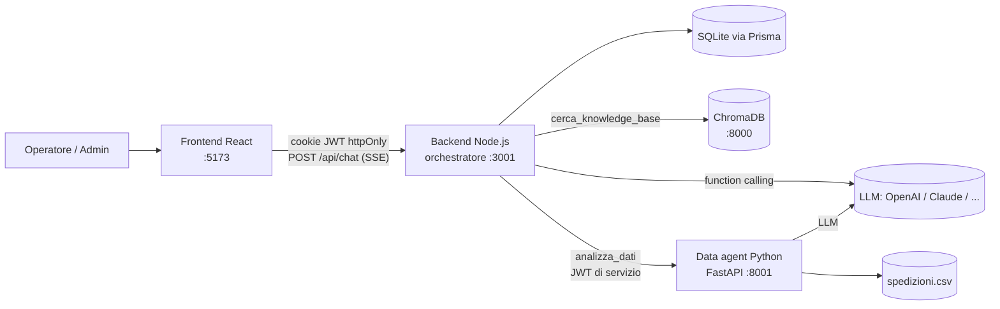

# LogisticAI

Piattaforma AI per il Customer Service e le Operations di un operatore logistico conto terzi (3PL).
Raccoglie i documenti aziendali in una libreria condivisa e, da un'unica chat, risponde sia a domande sui **documenti aziendali** (contratti SLA, procedure, condizioni di trasporto) sia a domande sui **dati delle spedizioni** (puntualità, danni, penali, margini), e decide da solo quale strumento usare, anche in sequenza.

Caso aziendale: **Padana Logistics S.r.l.**, 3PL fittizio con hub a Piacenza e Verona, 10 clienti con SLA dedicati e 5 vettori.

> Progetto finale del Master. Analisi completa e decisioni di progetto: [PROGETTO.md](PROGETTO.md).
> Repository GitHub: [github.com/AlessiaCattaneoDev/logisticai](https://github.com/AlessiaCattaneoDev/logisticai). Presentazione: [presentation/](presentation/)

---

## Indice

1. [Cosa fa](#cosa-fa)
2. [Architettura](#architettura)
3. [Requisiti](#requisiti)
4. [Installazione e avvio rapido](#installazione-e-avvio-rapido)
5. [Avvio manuale servizio per servizio](#avvio-manuale-servizio-per-servizio)
6. [Credenziali demo](#credenziali-demo)
7. [Variabili d'ambiente](#variabili-dambiente)
8. [Domande da provare](#domande-da-provare)
9. [Test e valutazioni](#test-e-valutazioni)
10. [Struttura del repository](#struttura-del-repository)
11. [Scelte progettuali](#scelte-progettuali)
12. [Risoluzione dei problemi](#risoluzione-dei-problemi)

---

## Cosa fa

| Domanda | Cosa succede |
|---|---|
| "Il destinatario ha accettato un collo danneggiato senza riserva: possiamo ancora fare reclamo?" | L'agente cerca nella **knowledge base** (RAG su ChromaDB) e risponde citando documento e sezione. |
| "Qual è il tasso di danni per vettore nel 2026?" | L'agente delega l'analisi al **data agent Python**, che pulisce il CSV, calcola il KPI e produce un grafico e una tabella interattivi. |
| "ModaNova ha diritto a penali per settembre 2026?" | L'agente **prima** legge le regole dello SLA nella knowledge base (soglia 95%, 1.000 € per punto, esclusioni), **poi** le passa al data agent, che calcola la penale: **1.700,00 €**. |

Inoltre:
- **Home dopo il login**: per ogni utente i suoi numeri (documenti disponibili, conversazioni, domande del mese, risposte trovate utili), le conversazioni da riprendere e i documenti aggiunti di recente; per l'admin anche costo AI di oggi, segnalazioni da rivedere e stato dei servizi.
- **Libreria documenti per categorie**: chiunque può caricare un PDF, un Word, un testo o un Markdown; il backend estrae il testo, lo divide in sezioni e lo indicizza nella knowledge base, e dopo pochi secondi l'assistente lo usa per rispondere. L'admin crea e rinomina le categorie; l'autore o l'admin possono eliminare un documento.
- **"Chiedi a questo documento"**: chat limitata a un documento o a una categoria, segnalata da un'etichetta corallo che si toglie con un clic.
- **Stati live** durante la risposta, mostrati come la timeline di tracking di una spedizione.
- **Grafici e tabelle interattivi** (React): cambio tipo di grafico, serie nascondibili, linea della soglia SLA, "Vedi dati", export CSV.
- **Conversazioni salvate** e feedback 👍/👎 su ogni risposta.
- **Dashboard admin**: costi AI per giorno e per periodo, costo medio per richiesta, token, tempi di risposta, decisioni dell'agente, conversazioni con trace tecnico, risposte segnalate, utenti, stato del sistema, registro accessi.
- **Login con ruoli** (operatore, amministratore) e autenticazione anche tra i microservizi.
- **Indipendenza dal provider AI**: OpenAI, Claude o un modello locale si cambiano dal file `.env`.

## Architettura

Quattro microservizi indipendenti che comunicano solo via HTTP:



| Servizio | Cartella | Tecnologia | Porta |
|---|---|---|---|
| Frontend | `frontend/` | React 19, Vite, TypeScript, Tailwind CSS, Recharts, TanStack Table | 5173 |
| Backend (orchestratore) | `backend/` | Node.js, TypeScript, Express 5, Prisma (SQLite), SDK OpenAI e Anthropic | 3001 |
| Data agent | `data_agent/` | Python 3.12, FastAPI, pandas, LangChain (tool calling, nessun codice eseguito) | 8001 |
| Vector store | `vector_db/` | ChromaDB server | 8000 |

Il cuore è il **loop ReAct** dell'orchestratore (`backend/src/orchestrator/agent.ts`): l'LLM ragiona, sceglie gli strumenti, legge i risultati e decide il passo successivo. Se in uno stesso passaggio chiede sia le regole sia l'analisi, il codice rinvia l'analisi finché il modello non ha letto le regole: la catena "regole poi dati" è garantita, non solo suggerita nel prompt.

## Requisiti

- **Node.js 20** o successivo (testato con 22)
- **Python 3.11 o 3.12** (testato con 3.12)
- Una **chiave API OpenAI** (modelli usati: `gpt-5.4-mini` ed embedding `text-embedding-3-small`)
- macOS o Linux per gli script automatici; su Windows usare l'[avvio manuale](#avvio-manuale-servizio-per-servizio) (WSL consigliato)

## Installazione e avvio rapido

```bash
# 1. Configurazione: copia il template e compila almeno OPENAI_API_KEY e i segreti
cp .env.example .env

# 2. Installazione completa: dipendenze JS e Python, database, utenti demo, indicizzazione della KB
scripts/setup.sh

# 3. Avvio dei 4 microservizi (Ctrl+C li ferma tutti)
scripts/start-all.sh
```

Poi apri **http://localhost:5173** e accedi con le [credenziali demo](#credenziali-demo).

I log di ogni servizio sono in `logs/`. Per generare i segreti richiesti dal `.env`:

```bash
openssl rand -hex 32   # una volta per JWT_SECRET e una per INTERNAL_SERVICE_SECRET
```

## Avvio manuale servizio per servizio

Utile per capire l'architettura o su Windows. Ogni comando va eseguito in un terminale separato, **in quest'ordine**, dalla root del repository.

### 0. Installazione (una volta sola)

```bash
npm install                                         # frontend, backend, tipi condivisi (npm workspaces)

python3.12 -m venv data_agent/.venv
data_agent/.venv/bin/pip install -r data_agent/requirements.txt

python3.12 -m venv vector_db/.venv
vector_db/.venv/bin/pip install -r vector_db/requirements.txt

cd backend
npx prisma migrate deploy                           # crea il database SQLite
npm run db:seed                                     # utenti demo e listini prezzi
cd ..
```

### 1. ChromaDB

```bash
vector_db/.venv/bin/chroma run --path vector_db/chroma_data --host 127.0.0.1 --port 8000
```

La prima volta, con Chroma avviato, indicizza la knowledge base:

```bash
cd backend && npm run ingest                        # registra i 10 documenti iniziali nella libreria e li indicizza
```

### 2. Data agent

```bash
cd data_agent
.venv/bin/uvicorn main:app --host 127.0.0.1 --port 8001
```

All'avvio il data agent controlla colonne e tipi del CSV: se il file non è valido non parte e scrive cosa non va. Le domande ripetute (anche scritte in modo leggermente diverso) si rispondono dalla cache, senza chiamare il modello (`DATA_AGENT_CACHE_TTL_S`, `DATA_AGENT_CACHE_MAX_VOCI` nel `.env`).

### 3. Backend

```bash
cd backend && npm run dev
```

All'avvio controlla che Chroma risponda e che la knowledge base sia stata indicizzata con lo stesso modello di embedding configurato; in caso contrario si ferma con un messaggio che indica cosa fare.

### 4. Frontend

```bash
cd frontend && npm run dev                          # http://localhost:5173
```

Su Windows sostituire `.venv/bin/` con `.venv\Scripts\`.

## Credenziali demo

Create da `npm run db:seed` con le password definite nel `.env` (`SEED_*`). Con il `.env` fornito:

| Utente | Password | Ruolo |
|---|---|---|
| `sara.operatrice` | `SaraDemo!2026` | Operatore: home, chat, documenti (carica ed elimina i propri), feedback |
| `admin` | `AdminDemo!2026` | Amministratore: in più gestione categorie e amministrazione (`/admin`) |

Credenziali valide **solo per la demo**.

## Variabili d'ambiente

Un unico file `.env` nella root, letto da backend e data agent. Il template completo e commentato è [`.env.example`](.env.example). Il file `.env` non è nel repository: va fornito a parte.

| Variabile | Esempio | A cosa serve |
|---|---|---|
| `OPENAI_API_KEY` | `sk-...` | Chiave del provider |
| `LLM_PROVIDER` / `LLM_MODEL` | `openai` / `gpt-5.4-mini` | Modello dell'orchestratore |
| `LLM_REASONING_EFFORT` | `medium` | Profondità di ragionamento dell'orchestratore |
| `DATA_LLM_PROVIDER` / `DATA_LLM_MODEL` | `openai` / `gpt-5.4-mini` | Modello del data agent |
| `EMBEDDING_PROVIDER` / `EMBEDDING_MODEL` | `openai` / `text-embedding-3-small` | Embedding della RAG |
| `JWT_SECRET` | 64 caratteri casuali | Firma delle sessioni utente |
| `INTERNAL_SERVICE_SECRET` | 64 caratteri casuali | Firma dei token backend → data agent |
| `SEED_ADMIN_PASSWORD` / `SEED_OPERATOR_PASSWORD` | | Password degli utenti demo |
| `DATABASE_URL` | `file:./prisma/dev.db` | Database SQLite (relativo a `backend/`) |
| `DAILY_BUDGET_EUR` / `MONTHLY_BUDGET_EUR` | `5` / `50` | Budget mostrati in dashboard |
| `RAG_MAX_DISTANCE` | `0.65` | Soglia di pertinenza dei documenti |

Per passare a **Claude**: `LLM_PROVIDER=anthropic`, `LLM_MODEL=claude-opus-5-5` e `ANTHROPIC_API_KEY`. Per un **modello locale** compatibile OpenAI (Ollama, vLLM): `LLM_PROVIDER=local` e `LLM_BASE_URL`. Nessuna altra modifica al codice.

## Domande da provare

| Tipo | Domanda | Risposta attesa |
|---|---|---|
| Documenti | Il destinatario ha accettato un collo danneggiato senza firmare con riserva: possiamo ancora aprire un reclamo? Entro quanto? | Solo per danno occulto, entro 8 giorni |
| Documenti | Qual è il tempo di consegna garantito per un Express verso la Sardegna? | Express non disponibile, servizio Isole in 3 giorni |
| Dati | Mostrami la puntualità mensile per hub negli ultimi 12 mesi. | Grafico con HUB-PC e HUB-VR, calo di Verona a fine anno |
| Dati | Qual è il tasso di danni per vettore nel 2026? Fammi un grafico. | VeloceExpress (VLX) circa 3,4%, gli altri sotto l'1% |
| Dati | Qual è il margine per cliente nel 2026? | CasaViva Arredo in perdita |
| Documenti e dati | ModaNova ha diritto a penali per settembre 2026? A quanto ammontano? | Sì: puntualità 93,3%, penale 1.700,00 € |
| Documenti e dati | ModaNova ha diritto a penali per luglio 2026? | No: 95,6% con le esclusioni dello SLA |
| Documenti e dati | Secondo la procedura di qualifica, qualche subvettore andrebbe sospeso? | Sì, VeloceExpress |
| Robustezza | Qual è la capitale della Francia? | Non risponde nel merito: spiega di cosa si occupa |
| Memoria | Dopo la domanda sui danni: "E solo per i clienti dell'hub di Verona?" | Ripete l'analisi filtrata su HUB-VR (VLX al 3,9%) |
| Documento caricato | Carica `backend/tests/fixtures/documents/policy-resi.docx`, poi "Chiedi a questo documento": "Entro quanto può chiedere il reso il destinatario e chi paga il ritiro?" | 30 giorni dalla consegna, ritiro a carico del cliente mittente |
| Ambito | Con l'etichetta su "Procedure di magazzino": "ModaNova ha diritto a penali per settembre 2026?" | Non lo trova in quel documento e propone di togliere l'ambito |

## Test e valutazioni

```bash
npm test                 # tutti i test automatici: tipi condivisi, backend, frontend, data agent, dataset, knowledge base
npm run typecheck        # controllo dei tipi TypeScript
```

| Parte | Strumenti | Test |
|---|---|---|
| Contratto delle spec di grafici e tabelle | Vitest + zod, pytest + pydantic sulle stesse fixture | 12 + 14 |
| Backend | Vitest + Supertest, database SQLite isolato, LLM finto, file PDF/DOCX/TXT reali | 190 |
| Frontend | Vitest + Testing Library + MSW | 62 |
| Data agent | pytest, LLM finto, sicurezza degli strumenti, validazione, cache, benchmark | 143 |
| Generatore del dataset | pytest: anomalie e storie nei dati | 37 |
| Knowledge base | pytest: coerenza con le regole di business, PDF aggiornato | 24 |

**Valutazioni con LLM reale** (costano qualche centesimo, servono i servizi avviati):

```bash
cd backend && npm run eval                           # 20 domande demo sul sistema completo, 3 con ambito
cd data_agent && .venv/bin/python -m pytest -m eval  # 3 analisi del data agent
```

**Benchmark delle prestazioni** (tempo e memoria su dataset da 12 mila a ~490 mila righe, nessun LLM):

```bash
cd data_agent && .venv/bin/python benchmark.py      # scrive data_agent/benchmark/RISULTATI.md
```

`npm run eval` verifica per ogni domanda gli strumenti usati e il loro ordine, i numeri attesi, le fonti citate e la presenza di grafici, e salva un report in `backend/evals/results/`. Ultimo risultato sulla suite completa, con il data agent a strumenti tipizzati: **20/20**.

## Struttura del repository

```
├── frontend/          React: home, libreria documenti, chat, grafici e tabelle, amministrazione
├── backend/           Node.js: autenticazione, orchestratore ReAct, RAG, libreria documenti, telemetria costi, API admin
│   ├── prisma/        schema del database, migrazioni, seed, listini prezzi
│   └── evals/         valutazioni end-to-end con LLM reale
├── data_agent/        Python: validazione e pulizia dati, KPI, agente a strumenti tipizzati, cache, benchmark, spec di grafici e tabelle
├── vector_db/         ChromaDB (dati in vector_db/chroma_data, esclusi da git)
├── shared/            tipi TypeScript condivisi e fixture del contratto JSON
├── data/              spedizioni.csv (12.240 righe), generatore, regole di business, manifest delle anomalie
├── knowledge_base/    10 documenti Markdown + Manuale_Operativo_Padana_Logistics.pdf
├── presentation/      presentazione del progetto
├── scripts/           setup.sh, start-all.sh
└── PROGETTO.md        analisi e progettazione
```

### Dati e knowledge base

- **`data/spedizioni.csv`**: 12.240 spedizioni (ottobre 2024 - settembre 2026) con circa il 10% di anomalie inserite di proposito (duplicati, date in formati diversi, categorie scritte in modi diversi, numeri come testo, valori impossibili, incoerenze). È generato in modo riproducibile da `data/generate_dataset.py`; le anomalie sono documentate in `data/anomalie_manifest.json`.
- **`knowledge_base/Manuale_Operativo_Padana_Logistics.pdf`**: 16 pagine, generate dalle sorgenti in `knowledge_base/source/`.
- Clienti, soglie, penali e tempi di consegna sono definiti una volta sola in `data/business_rules.json`: i test verificano che CSV e documenti siano coerenti.

## Scelte progettuali

- **Documenti elaborati nel backend.** Estrazione del testo (PDF con `unpdf`, Word con `mammoth`), divisione in sezioni e indicizzazione avvengono in una coda dentro il backend, che già possiede embedding, Chroma e telemetria: nessun servizio in più da avviare. Il file è controllato per estensione, firma reale e dimensione (15 MB); un PDF scansionato senza testo finisce in stato "Errore" con il motivo.
- **FastAPI invece di `child_process`.** Il data agent è un vero microservizio: carica il CSV una volta, ha un health check, è autenticato e si può scalare a parte.
- **Grafici come componenti React, non immagini.** Il brief suggerisce matplotlib o seaborn con immagini salvate su disco. LogisticAI fa produrre al data agent una *specifica JSON* del grafico (`ChartSpec` / `TableSpec`), che il frontend disegna con Recharts e TanStack Table. I grafici diventano interattivi e coerenti con l'interfaccia, e non ci sono file da proteggere. Il requisito sostanziale resta: l'agente Python analizza i dati e genera i grafici, che compaiono in chat.
- **I numeri che diventano soldi non dipendono dal codice generato dall'LLM.** Penali SLA e qualifica dei vettori si calcolano con funzioni deterministiche e testate (`data_agent/kpi.py`). L'agente sceglie quale usare e con quali regole, lette dalla knowledge base.
- **Livello AI indipendente dal provider.** Il backend usa interfacce neutre (`backend/src/llm/types.ts`) e un adapter per provider (OpenAI Responses API, OpenAI compatibile, Anthropic), verificati dalla stessa suite di test di conformità.
- **Sicurezza.** Password con argon2, JWT in cookie httpOnly e SameSite=Strict, ruoli, limite ai tentativi di login, JWT di servizio di 60 secondi tra backend e data agent, nessun segreto nel codice.
- **Privacy.** Il dataset non contiene dati personali dei destinatari. In dashboard gli utenti sono pseudonimizzati; mostrare i nomi e aprire una conversazione sono azioni registrate nel registro accessi.

## Risoluzione dei problemi

| Problema | Soluzione |
|---|---|
| Il backend si ferma con "ChromaDB non raggiungibile" | Avvia Chroma prima del backend (passo 1) |
| "Knowledge base non indicizzata" o "indicizzata con un altro modello" | Con Chroma avviato: `cd backend && npm run ingest` |
| "Configurazione non valida (.env)" | Il messaggio elenca le variabili mancanti: compilale in `.env` |
| Le analisi dei dati non rispondono | Verifica che il data agent sia attivo: `curl http://127.0.0.1:8001/health` |
| Login rifiutato | Rilancia `cd backend && npm run db:seed` dopo aver impostato le password `SEED_*` |
| Porta già in uso | Ferma il processo sulla porta (8000, 8001, 3001, 5173) o cambia la porta nel `.env` |
| La dashboard mostra "modelli senza listino" | Aggiungi il prezzo del modello in *Costi e modelli* |

**Limiti noti.** `npm audit` segnala vulnerabilità in dipendenze indirette della CLI di Prisma (driver MySQL non usato: il progetto usa SQLite). L'unica correzione proposta è tornare a Prisma 6, un cambiamento incompatibile, quindi non è applicata.

## Costi

Ogni chiamata ai modelli è registrata con token, costo e tempo, visibili nella dashboard admin. Con `gpt-5.4-mini` una risposta costa in media circa **0,02 €**. Lo sviluppo e tutte le prove dal vivo del progetto sono costati meno di 1 €.
